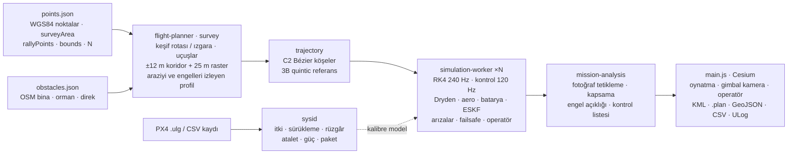
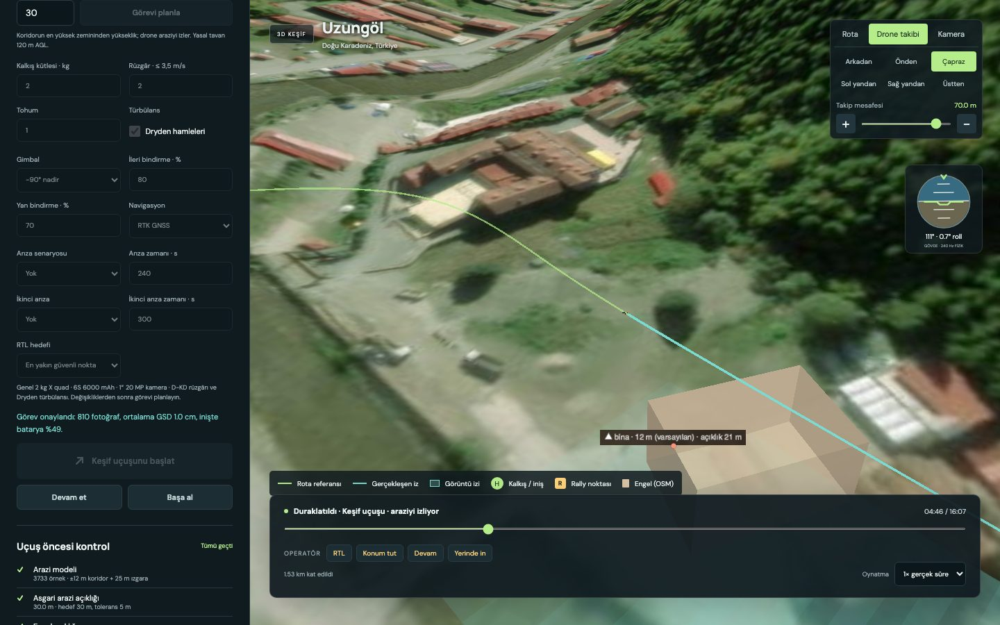
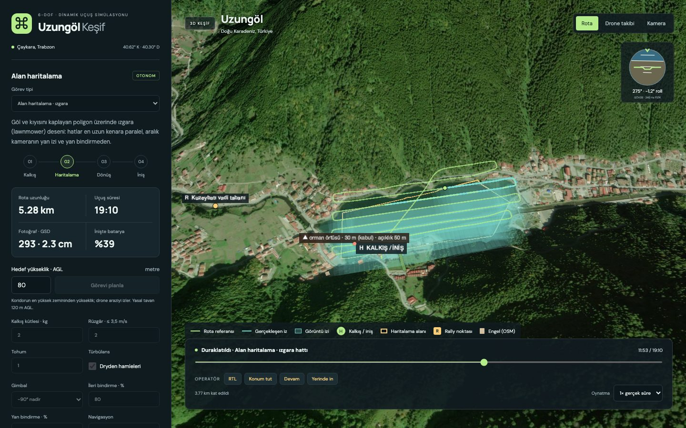
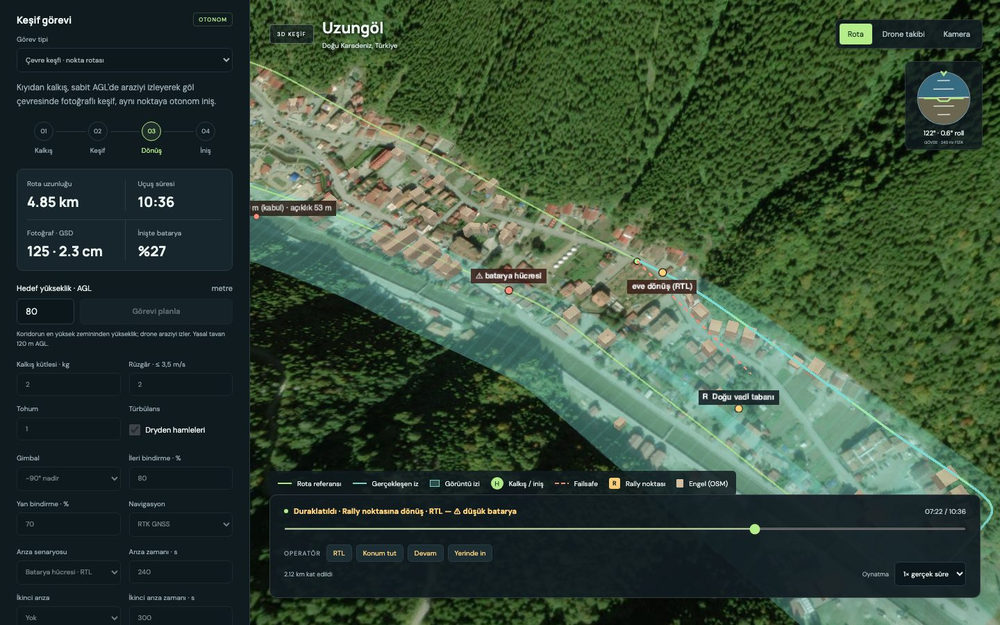

<div align="center">


# Uzungöl Drone Keşfi

**Gerçek arazi üzerinde, tarayıcıda çalışan profesyonel quadrotor keşif uçuşu simülasyonu**

[](https://github.com/yucel-gumus/cesium-drone.github.io/actions/workflows/ci.yml)
[](https://cesium.com/platform/cesiumjs/)
[](https://nodejs.org/)
[](https://playwright.dev/)
[](https://yucel-gumus.github.io/cesium-drone.github.io/)

[**🌐 Canlı demo**](https://yucel-gumus.github.io/cesium-drone.github.io/) · [Hızlı başlangıç](#-hızlı-başlangıç) · [Görev akışı](#-görev-akışı) · [Engeller](#-engeller-bina-ve-ağaç) · [Alan haritalama](#-alan-haritalama) · [Enerji](#-enerji) · [Navigasyon](#️-navigasyon) · [Arıza ve failsafe](#️-arıza-enjeksiyonu-ve-failsafe) · [Kalibrasyon](#-uçuş-kaydıyla-kalibrasyon) · [Doğrulama](#-doğrulama)


</div>

Bir operatörün sahada yürüttüğü keşif görevini uçtan uca modeller: görev planlanır, **uçuş öncesi kontrol listesinden** geçer, drone Uzungöl'ün (Çaykara, Trabzon) gerçek arazisi üzerinde **sabit AGL'de araziyi izleyerek**, OpenStreetMap'teki **bina ve orman engellerinden** güvenli açıklıkla, bir keşif rotasını ya da bir poligonu kaplayan **alan haritalama ızgarasını** (gerekirse **batarya değişimli birkaç uçuşta**) uçar, kamera mesafeye göre fotoğraf çeker, batarya rezerviyle eve döner ve **iniş dedektörüyle** motorlarını durdurur. Uçuşa zamanı seçilen **bir ya da iki arıza enjekte edilebilir** (batarya hücresi, GNSS kesintisi/kaybı, motor verim kaybı); otopilotun failsafe'leri buna **en yakın güvenli noktaya (rally) dönüş**, ölü hesapla konum tutma veya yerinde inişle tepki verir, **operatör de oynatma sırasında RTL, konum tutma, devam ve yerinde iniş komutlarıyla** uçuşu devralabilir. Uçuş bir animasyon değil: 240 Hz'de çözülen 6 serbestlik dereceli rijit cisim dinamiğidir; yer etkisi, vortex ring durumu, rotor sürüklemesi ve kanat çırpması (blade flapping) dahildir. Kontrolcü gerçek durumu değil, **IMU, GNSS, barometre ve manyetometreyi birleştiren 17 durumlu hata durumlu Kalman filtresinin (ESKF)** kestirdiği konumu, hızı, yönelimi ve rüzgârı kullanır. Görev sonunda plan ve kayıt KML, QGroundControl `.plan` (Survey öğesiyle), GeoJSON, CSV ve **PX4 ULog** olarak dışa aktarılır; gerçek bir **PX4 uçuş kaydı yüklenerek** model kalibre edilebilir.

Model, ölçümlerle tanımlanmış ticari bir drone değil; açık parametreli **genel 2 kg X quad**, genel 6S LiPo batarya ve genel 1″ 20 MP haritalama kamerasıdır. Gerçek bir araca yaklaştırmak için [uçuş kaydıyla kalibrasyon](#-uçuş-kaydıyla-kalibrasyon) aracı vardır; bu depoda gerçek bir uçuş kaydıyla yapılmış bir kalibrasyon yoktur.

## ✨ Öne çıkanlar

- 🏔️ **Araziyi izleyen uçuş.** Koridorun en yüksek zemininden sabit yükseklikte, tırmanma ve alçalma hızı sınırlı, önceden yükselen yumuşak bir dikey profil. Yasal **120 m AGL** tavanı denetlenir.
- 🏢 **Engeller.** OpenStreetMap'ten 1150 engel (1054 bina, 87 orman alanı, ağaç sıraları, verici direği, minareler): profil hedef AGL'nin yetmediği yerde engel tepesinin 20 m üstüne yükselir, uçulan iz engel açıklığına göre denetlenir, kalkış ve rally noktalarının çevresi kontrol edilir.
- 📷 **Kamera yükü.** Gerçek sensör geometrisiyle GSD, %80 ileri bindirme için mesafe tabanlı tetikleme, araziye düşen görüntü izleri ve drone kamerasından **canlı gimbal görünümü**.
- 🗺️ **Alan haritalama.** Poligon üzerinde lawnmower ızgarası; hatlar en uzun kenara paralel, aralık kameranın yan izinden ve %60–80 **yan bindirmeden**. Tek bataryaya sığmayan ızgara **batarya değişimli uçuşlara** bölünür; QGroundControl'e **Survey (TransectStyle) öğesi** olarak aktarılır.
- ⚠️ **Arıza, failsafe ve operatör.** Batarya hücresi, GNSS kesintisi/kaybı ve motor verim kaybı, **iki arıza birlikte** de seçilebilir. Otopilot **rüzgârı hesaba katan dönüş şarjıyla** RTL'e karar verir, **en yakın güvenli noktaya** (rally) ya da eve döner, GNSS yokken ölü hesapla konum tutar, gerekirse yerinde iner. Operatör oynatma sırasında **RTL / konum tut / devam / yerinde in** komutu verebilir; uçuş o andan itibaren deterministik olarak yeniden çözülür.
- 🌬️ **Rüzgâr.** Dryden türbülansı, **kütleye bağlı rüzgâr yetki sınırı** (1,5 kg'da 2,0, 2 kg'da 3,5, 3 kg'da 5,8 m/s) ve uçuş sırasında **rüzgâr kestirimi**; kestirim sürükleme ileri beslemesine ve dönüş enerjisine girer.
- 🧭 **Navigasyon.** 17 durumlu ESKF: konum, hız, yönelim, ivmeölçer ve jiroskop sapmaları ve yatay rüzgâr. RTK ile santimetre, standart GNSS ile metre düzeyinde kestirim; yönelim hatası 0,5° civarında. PX4 tarzı iniş dedektörü.
- 🌀 **Aerodinamik.** Yer etkisi, vortex ring durumu, rotor devriyle ölçeklenen rotor sürüklemesi (H-kuvveti) ve kanat çırpması momenti.
- 🔋 **Enerji modeli.** Rotor torkundan elektrik gücü, LiPo gerilim eğrisi ve iç direnç, gerilim düşümüyle azalan motor yetkisi, **%25 iniş rezervi**.
- 🔧 **Uçuş kaydıyla kalibrasyon.** PX4 `.ulg` ya da CSV kaydından itki katsayısı, sürükleme, rüzgâr, atalet, kanat çırpması, itki verimi ve paket direnci kestirilir; tutarlı çıkanlar uygulanır.
- ✅ **Uçuş öncesi kontrol listesi.** On beş madde (alan haritalamada on altı); engelleyici bir madde düşerse görev uçurulamaz ama incelenebilir. Arıza ya da operatör senaryosunun sonucu ayrı bir öneri grubunda gösterilir.
- 📤 **Standart çıktılar.** KML (deniz seviyesine göre), QGroundControl `.plan` (MAVLink komutları, Survey öğesi, rally noktaları), GeoJSON (RFC 7946), 42 sütunlu CSV ve PX4 ULog.
- 🔁 **Deterministik ve doğrulanmış.** Aynı girdi bit düzeyinde aynı uçuşu verir. 92 birim testi, gerçek arazide 32 kontrollük Playwright regresyonu, her push'ta GitHub Actions.

## 🚀 Hızlı başlangıç

Node.js **22.15+** ve Cesium World Terrain (asset 1) erişimli bir [Cesium ion](https://ion.cesium.com/) tokenı gerekir.

```sh
npm ci
cp .env.example .env      # CESIUM_ION_TOKEN=... satırını doldurun
npm start                 # http://localhost:9000
```

| Komut                    | Ne yapar                                                                         |
| ------------------------ | -------------------------------------------------------------------------------- |
| `npm start`              | Webpack geliştirme sunucusu, kaynak değişince yeniden derler                      |
| `npm run build`          | Üretim derlemesi `dist/` altına; GLB'den yazısız `drone.glb` üretir               |
| `npm run preview`        | `dist/` dizinini `http://127.0.0.1:9001/cesium-drone.github.io/` adresinde sunar |
| `npm test`               | 92 birim testi (Node yerleşik test runner)                                       |
| `npm run verify:browser` | Playwright ile gerçek arazide 32 kontrollük tarayıcı regresyonu                   |
| `node scripts/fetch-obstacles.mjs` | `public/obstacles.json` engel anlık görüntüsünü OpenStreetMap'ten yeniler |
| `npm run deploy`         | Üretim derlemesini `gh-pages` dalına yayınlar                                    |

Token tarayıcıda kullanılır; Cesium ion üzerinden izinlerini ve alan adlarını kısıtlayın. `.env` Git'e girmez. Arayüzdeki **Harita erişim ayarı** bölümüne girilen alternatif token yalnızca sekme oturumunda saklanır.

## 🧭 Görev akışı



Operatör açısından akış şöyledir:

1. **Planla.** Görev tipi (**çevre keşfi** ya da **alan haritalama**), hedef AGL, kalkış kütlesi, rüzgâr, gimbal açısı, ileri ve yan bindirme, navigasyon kalitesi, isteğe bağlı **bir ya da iki arıza** ile zamanları ve RTL hedefi (en yakın güvenli nokta / yalnızca ev) seçilir; **Görevi planla** arazi koridorunu örnekler ve bütün uçuşu Web Worker içinde çözer. Arıza seçiliyse plan paralel worker'larda çözülür: arızasız (kontrol listesi için) ve arızalı (oynatılan uçuş); çok uçuşlu bir haritalamada her uçuş ayrı çözülür. Arazi yükseklikleri konumlarına göre önbelleğe alınır; yeniden planlamada yalnızca yeni noktalar örneklenir.
2. **Kontrol et.** Uçulan iz araziye, engellere, yasal tavana, coğrafi sınıra, bataryaya ve motor yetkisine karşı denetlenir. Engelleyici bir madde düşerse başlat düğmesi kilitlenir; plan zaman çubuğuyla yine incelenebilir. Arıza ya da operatör senaryosunun sonucu ayrı bir grupta raporlanır ve planı engellemez.
3. **Uç.** Görev 30 Hz kayıttan oynatılır. **Rota**, **Drone takibi** (altı açı) ve **Kamera** görünümleri arasında geçilir; telemetri, batarya göstergesi ve uçuş günlüğü canlı izlenir. Operatör oynatma sırasında **RTL**, **Konum tut**, **Devam** ve **Yerinde in** komutlarını verebilir.
4. **Teslim et.** Plan ve kayıt beş formatta dışa aktarılır; ULog kaydı aynı zamanda kalibrasyon aracının girdisidir.

Uçuş fazları sırasıyla `arming`, `takeoff`, `survey`, `return`, `settle`, `landing`, `touchdown`, `disarm` ve `complete`'tir. Alan haritalamada ızgaraya geçiş `transit`, ızgara `survey`, eve geçiş `return` olarak işaretlenir; failsafe'ler ve operatör komutları `hold` (rota üzerinde durup konum tutma) ve `rtl` (eve ya da rally noktasına dönüş) fazlarını ekler. Kayıttaki 0–8 faz kodlarının anlamı değişmez; yeni fazlar 9 `hold`, 10 `rtl`, 11 `transit` kodlarını alır.

## 🏔️ Araziyi izleyen uçuş

Profesyonel keşif sabit tavanda değil sabit yerden yükseklikte uçar: görüntü çözünürlüğü ve kapsama yere olan mesafeye bağlıdır. Rota en fazla 6 m aralıkla, merkez ve her iki yanda ±12 m koridorla Cesium World Terrain üzerinden örneklenir. Her rota düğümü için gereksinim, o kesitteki en yüksek zemin artı hedef AGL'dir. Dikey profil üç adımda kurulur:

Gereksinim, koridorda ya da 10 m yanında bir engel varsa `max(hedef AGL, engel yüksekliği + 20 m)` olur (bkz. [Engeller](#-engeller-bina-ve-ağaç)); varsayılan 80 m'de Uzungöl'deki engellerin hiçbiri profili değiştirmez.

1. **Genişletme.** Gereksinim ±40 m boyunca en büyük değere genişletilir: drone sırttan önce tırmanır, sonra alçalır.
2. **Eğim sınırı.** Seyir hızında 3 m/s tırmanma ve 2,5 m/s alçalmayı aşmayacak şekilde yalnızca yükseltilir; açıklık hiçbir yerde azaltılmaz.
3. **Yumuşatma.** Desteği genişletme penceresinin içinde kalan (3σ = 36 m ≤ 40 m) Gauss çekirdeği uygulanır.

Genişletilmiş ve yalnızca yükseltilmiş bir diziyi pencereden dar bir çekirdekle ortalamak, her noktayı kendi gereksiniminin üstünde tutar ve eğimi artıramaz. Profil, yatay hız planıyla aynı quintic parçalara üçüncü eksen olarak girer: konum, hız ve ivme üç eksende süreklidir; dikey ivme 1 m/s², jerk 2 m/s³ ile sınırlıdır. Uçuş sonrası denetim, uçulan izin keşif ve dönüş fazlarındaki açıklığını koridor zeminine göre, uçuş boyunca en yüksek AGL'yi ise hemen alttaki zemine göre ölçer.

Gerçek Uzungöl arazisinde varsayılan 80 m hedefle ölçülen değerler:

| Ölçüm                              | Değer                          |
| ---------------------------------- | ------------------------------ |
| Koridor zeminine en düşük açıklık  | 80,0 m                         |
| En yüksek AGL                      | 99,7 m                         |
| Engel tepesine en düşük açıklık    | 52,7 m (30 m kabul edilen orman örtüsü) |
| Azami takip hatası                 | 0,16 m                         |
| Uçuş süresi                        | 16:46                          |

Hedef AGL 110 m seçilirse vadi üzerinde 129,8 m'ye çıkılır ve **yasal irtifa tavanı** maddesi planı engeller. Kalkış ve iniş bölgesinde AGL, hemen alttaki zemine göre ölçülür; elipsoit, yaklaşık MSL ve kalkışa göre yükseklik ayrıca gösterilir.

## 🏢 Engeller (bina ve ağaç)

<div align="center">

</div>

Sayısal yükseklik modeli (DEM) çıplak araziyi verir; binalar, ağaçlar ve direkler onda yoktur. Engeller, rota kutusu için OpenStreetMap'ten alınmış bir **anlık görüntüden** (`public/obstacles.json`, Overpass API, 2026-10-18, © OpenStreetMap katkıda bulunanlar, ODbL) gelir ve `node scripts/fetch-obstacles.mjs` ile yenilenir. Her engel bir taban izi (nokta + yarıçap, çizgi + yarı genişlik ya da poligon) ve zeminden yüksekliktir:

| Tür | Uzungöl'de | Yükseklik |
| --- | ---------- | --------- |
| Bina | 1054 | `height` etiketi; yoksa `building:levels × 3 m + 3 m çatı`; o da yoksa 12 m (otel 15 m) **varsayılan** |
| Orman / koru | 87 poligon | 30 m **kabul edilen** taç yüksekliği (olgun Doğu ladini meşceresi); OSM'de ağaç yüksekliği yoktur |
| Ağaç sırası | 6 | 15 m kabul, 5 m yarı genişlik |
| Direk / kule | TRT verici direği, 2 minare | etiket yoksa direk 40 m, minare 25 m varsayılan |

Bina yüksekliklerinin dördü dışında hepsi varsayılandır; bu yüzden denetim **yükseklik kaynağını** (etiket, kat sayısı, varsayılan, kabul) her zaman yazar. Rota dosyası `obstacles` alanıyla kendi engellerini (ör. ölçülmüş bir direk ya da elektrik hattı) ekleyebilir.

- **Planlama:** her koridor istasyonunda koridor ve 10 m tampon içindeki en yüksek engel bulunur; gereksinim `zemin + max(hedef AGL, engel + 20 m)` olur. Varsayılan 80 m'de Uzungöl'de hiçbir istasyon yükselmez; **30 m AGL**'de 811 istasyonun 306'sı orman örtüsü ve binalar için yükseltilir ve en yüksek AGL 57,2 m olur.
- **Denetim:** uçulan izin her 0,2 saniyesinde 10 m tampon içindeki engellerin tepesine dikey açıklık ölçülür (engelin zemini, engelin izdeki en yakın noktasından). **Engel açıklığı** engelleyici bir maddedir: açıklık ≥ 20 − 5 m olmalıdır. Varsayılan uçuşta 52,7 m (orman örtüsü), 30 m AGL'de 20,9 m (bir bina).
- **Kalkış ve iniş alanları:** kalkış noktası ve her rally noktası çevresindeki en yakın engel raporlanır (öneri maddesi; dikey tırmanış/iniş için 10 m tampon boş olmalı). Uzungöl'de kalkış noktasına en yakın bina 10,6 m, rally noktalarına 15 m ve 18 m'dir.
- **Arıza sonrası:** arızalı uçuşun engel açıklığı ayrıca raporlanır; yerinde ya da rally noktasına iniş bir binanın ya da ormanın üstüne denk gelirse **Arıza sonrası iniş** maddesi bunu yazar.
- **Harita:** rotanın 40 m yakınındaki binalar, direkler ve ağaç sıraları modellenen zemin üzerinde prizma olarak çizilir (Uzungöl'de 108 engel); en düşük açıklığı veren engel etiketlenir.

Sınırlar: anlık görüntü güncel değildir ve OSM eksik olabilir; ağaç yüksekliği ölçülmemiştir (gerçek taç yüksekliği için LiDAR/DSM gerekir); bölgede OSM'de elektrik hattı ya da teleferik kaydı yoktur, böyle engeller rota dosyasına elle eklenmelidir.

## 📷 Kamera yükü

<div align="center">

</div>

| Parametre               | Değer                                           |
| ----------------------- | ----------------------------------------------- |
| Sensör                  | 1″, 13,2 × 8,8 mm, 5472 × 3648 piksel (20 MP)   |
| Odak uzaklığı           | 8,8 mm · görüş açısı 73,7° × 53,1°              |
| Pozlama / asgari aralık | 1/1000 s / 0,7 s                                |
| Gimbal                  | 3 eksen stabilize; −90° nadir, −70°, −60°, −45° |
| Görüntü yönü            | Uzun kenar uçuş yönüne dik                      |

- **GSD** (yer örnekleme aralığı) optik eksen boyunca eğik mesafeden hesaplanır: `GSD = mesafe × sensör genişliği / (odak × görüntü genişliği)`. 80 m'de nadir görüntüde 2,19 cm/piksel.
- **Tetik aralığı**, planlanan AGL'deki uçuş yönündeki iz uzunluğunun `1 − bindirme` katıdır; görev planlayıcıların `MAV_CMD_DO_SET_CAM_TRIGG_DIST` ile kullandığı mesafe tabanlı tetiklemedir. 80 m ve %80 bindirmede 16 m.
- Uçulan iz yeniden oynatılır ve kamera her tetik mesafesinde gerçek konum ve yönelimle ateşlenir. Her karenin dört köşe ışını yere düşürülerek **görüntü izi** hesaplanır; izler haritada çekildikleri anda belirir.
- **Kamera** görünümü Cesium kamerasını drone'un konumuna, gövde yönüne ve gimbal eğimine yerleştirir, sensörün görüş açısını uygular, drone modelini ve plan katmanlarını gizler. HUD fotoğraf sayacını, çekim anında yanan REC işaretini, AGL'yi ve anlık GSD'yi gösterir. Uydu görüntüsü Uzungöl'de mevcut en ince seviye olan 18'e (yaklaşık 0,45 m/piksel) kadar açılır.

Gerçek arazide ölçülen kapsama:

| Ayar                | Kare | Ortalama GSD | Tetik  | Asgari bindirme | Hareket bulanıklığı |
| ------------------- | ---- | ------------ | ------ | --------------- | ------------------- |
| 80 m, −90°, %80     | 304  | 2,29 cm      | 16,0 m | %80             | 0,34 piksel         |
| 60 m, −90°, %80     | 405  | 1,75 cm      | 12,0 m | %80             | 0,45 piksel         |
| 80 m, −45°, %80     | 114  | 3,24 cm      | 42,7 m | %80             | 0,24 piksel         |

## 📐 Alan haritalama

<div align="center">

</div>

**Görev tipi · Alan haritalama** seçildiğinde drone, rota dosyasındaki `surveyArea` poligonunu (WGS84) fotogrametri planlayıcılarının uçtuğu biçimde bir **lawnmower (boustrophedon) ızgarasıyla** kaplar; kalkış ve iniş yine ilk keşif noktasındadır.

- **Hat yönü** poligonun en uzun kenarına paraleldir: dönüş sayısı en aza iner ve Uzungöl'de hatlar vadi boyunca, eğimin en az olduğu yönde uzanır.
- **Hat aralığı** `d = (1 − yan bindirme) × W`'dir; `W`, kameranın düz zemindeki yan izidir (görüntünün yakın kenarı; nadirde `AGL × 13,2 / 8,8 = 1,5 × AGL`). 80 m'de W = 120 m, %70 yan bindirmede d = 36 m. Yan bindirme arayüzde %60–80 (varsayılan %70) seçilir.
- **Hat sayısı** genişliği tam kaplar: `n = ⌈genişlik / d⌉ + 1`, ızgara poligona ortalanır; en dıştaki hatlar kenarların üzerinde ya da en fazla d/2 dışındadır, kenar şeridi de planlanan bindirmeyle görüntülenir. Her hat poligonu kendi şeridi (±d/2) boyunca keser ve iki uçta 15 m uzatılır (QGroundControl'deki "turnaround distance"): dönüşler poligonun dışında yapılır.
- **Dönüş:** `roundedPath` 180° dönüşü reddettiği için bir hattın sonu bir sonrakinin başına **iki 90° köşeyle** bağlanır; ortak dönüş koordinatı iki hattın daha uzak ucudur, bağlantı bacağı hatlara diktir. Izgarada köşeler komşu bacakların yarısını kullanabilir (keşif rotasında %24): 36 m'lik dönüş bacağının tamamı eğriye dönüşür.
- **Giriş ve çıkış:** dört uçuş biçiminden (ilk ya da son hattan, iki yönde) eve geçişleri en kısa olan ve hiçbir köşesi 150°'yi aşmayan seçilir. Kalkış noktası Uzungöl'deki gibi bir hattın ekseni üzerindeyse geçiş, hatta ters yönde girmek yerine ızgaranın 30 m dışındaki bir noktadan dik açıyla girer.
- **Hız profili:** keşif rotasının ivme sınırlı hız profili rampaların başında ve sonunda ivmeyi bir düğümde değiştirir; quintic parçalar bunu jerk sıçramasına çevirir ve talep döngüsü geniş bir bölgeyi yavaşlatır. Izgara ve failsafe bacaklarında hızın karesi ±10 m pencerede önce aşındırılır, sonra kutu ortalamasından geçirilir: aynı genişlikte minimum filtrenin ortalaması özgün değeri hiçbir yerde aşmaz (hız sınırları korunur), boyuna ivme ise sürekli hâle gelir. Uzungöl ızgarasının yatay süresi (düz zeminde) 1110 s'den 878 s'ye iner; hatlar 7,8 m/s, dönüşler en az 3,1 m/s ile uçulur (yumuşatmasız 1,8 m/s). Keşif rotasının profili değişmez.
- **Arazi:** her hat keşif rotası gibi ±12 m koridorla örneklenir, araziyi izleyen profil ve bütün kontrol listesi maddeleri aynen uygulanır.
- **Kamera** yalnızca ızgarada (`survey` fazı, dönüşler dahil) tetiklenir; ızgaraya geçişte ve eve dönüşte kapalıdır.
- **Çok uçuşlu ızgara:** ızgaranın tahmini süresi bir bataryanın izin verdiğini aşarsa hatlar **ardışık bloklara** bölünür ve her blok kendi kalkış–iniş uçuşu olur (batarya değişimi). Sınır askı gücünden hesaplanır: `0,70 × E / (1,02 × P_askı)` (rezerv ve %5 pay düşülmüş kullanılabilir enerji); uçuş sayısı sığan en küçük sayıdır, hatlar uçuşlara eşit dağıtılır, her uçuş en az iki hat içerir. Süre tahmini (kalkış/iniş, %70 seyirde geçişler, %95 seyirde hatlar, dönüş başına 30 s) çözülen ızgaralara birkaç yüzde içinde oturur; her uçuş ayrıca çözülür ve kendi rezerv denetiminden geçer. Arayüzde uçuşlar arasında geçilir; kapsama ve yan bindirme **bütün uçuşların fotoğraflarıyla, bütün hatlara karşı** değerlendirilir. Arıza ilk uçuşa enjekte edilir.
- **QGroundControl Survey öğesi:** `.plan` dosyasında ızgara, QGC'nin `ComplexItem` / `survey` (sürüm 5) öğesidir: poligon, hat açısı (kuzeyden saat yönünde), `TransectStyleComplexItem` (sürüm 2: dönüş mesafesi 15 m, dönüşlerde tetik açık, hat uçları) ve `CameraCalc` (sürüm 2: 13,2 × 8,8 mm sensör, 5472 × 3648 piksel, 8,8 mm, yan iz ve tetik aralığı, bindirmeler). Mesafe modu **"arazinin üstünde hesaplanan"**dır; QGC bu modda dosyadaki `Items` dizisini olduğu gibi uçurur, yani araziyi izleyen yüksekliklerimiz korunur. Anahtarlar QGroundControl kaynağındaki yükleyicinin zorunlu tuttuklarıyla birebir aynıdır ve birim testinde denetlenir. Öğe QGC'de düzenlenirse QGC hatları poligondan ve kameradan kendisi yeniden üretir. `surveyItem: false` ile ızgara düz ara noktalar olarak da yazılabilir.
- **Kapsama:** gerçekleşen **yan bindirme**, uçulan fotoğraflardan her hattın gerçek ekseni (medyan) ve görüntü genişliğiyle komşu hat çiftleri için `1 − ayrım / ortalama genişlik` olarak ölçülür; **kaplanan alan yüzdesi** poligon içindeki 5 m aralıklı noktaların en az bir görüntü izine düşen oranıdır. Kontrol listesine **Alan kapsaması** öneri maddesi eklenir (alanın ≥ %98'i ve yan bindirme ≥ hedef − %5).

Gerçek arazide, 2 kg, RTK, −90° gimbal ve %80 ileri bindirmeyle ölçülen ızgaralar (12,5 ha):

| AGL · yan bindirme | Hat · aralık | Uçuş · rota | Süre | Kare · GSD | Kaplanan alan · asgari yan bindirme | İnişte batarya | Kontrol listesi |
| ------------------ | ------------ | ----------- | ---- | ---------- | ----------------------------------- | -------------- | --------------- |
| 80 m · %70 | 8 · 36 m | 1 · 5,28 km | 19:10 | 293 · 2,26 cm | %100 · %70 | %39 | geçti; açıklık 79,4 m, en yüksek 101,4 m AGL |
| 80 m · %80 | 12 · 24 m | 2 · 4,09 + 3,79 km | 15:46 + 14:54 | 231 + 193 · 2,26 cm | %100 · %80 | %50 · %53 | iki uçuş da geçti |
| 60 m · %70 | 11 · 27 m | 2 · 4,13 + 3,25 km | 14:58 + 13:00 | 311 + 208 · 1,72 cm | %100 · %70 | %53 · %59 | iki uçuş da geçti |
| 100 m · %70 | 7 · 45 m | 1 · 5,15 km | 19:34 | 223 · 2,84 cm | %100 · %70 | %38 | engellendi: 126,1 m AGL tavanı aşıyor |

Tek uçuşta rezervin altına düşecek sık ızgaralar (%80 yan bindirme, 60 m) iki uçuşa bölünür; ikisi de %50'nin üstünde iner ve birlikte alanın tamamını planlanan yan bindirmeyle kaplar. Poligonun kuzeyindeki yamaç 100 m hedefte 120 m tavanını yine çiğner ve kontrol listesi planı engeller. Yatay hız planı ızgarada en büyük takip hatasını 0,21 m'de tutar.

## 🔋 Enerji

Her fizik adımında dört rotorun mil gücü `Σ κ f_i ω_i` (κ: reaksiyon torku / itki) hesaplanır, itki zinciri verimiyle elektrik gücüne çevrilir ve aviyonik yük eklenir. Paket Thevenin modeliyle çözülür: açık devre gerilimi şarj durumuna bağlı LiPo eğrisinden gelir, `P = V I` ve `V = E − I R` birlikte çözülür, şarj Coulomb sayımıyla düşer. Fırçasız motor devri gerilimle ölçeklendiğinden, **düşen gerilim azami rotor devrini ve kontrol yetkisini azaltır**.

| Parametre                  | Değer                               |
| -------------------------- | ----------------------------------- |
| Paket                      | 6S LiPo, 6000 mAh, yaklaşık 133 Wh  |
| İç direnç                  | 30 mΩ                               |
| İtki zinciri verimi        | %78 (ESC × motor)                   |
| Aviyonik + gimbal kamera   | 18 W                                |
| İniş rezervi               | %25                                 |
| Asgari hücre gerilimi      | 3,3 V (paket 19,8 V)                |

Gerçek arazide, 80 m hedefle, kalkış kütlesine göre ölçülen sonuçlar:

| Kalkış kütlesi | Ortalama güç | Enerji   | İnişte batarya | Rüzgâr sınırı | Kontrol listesi                                     |
| -------------- | ------------ | -------- | -------------- | ------------- | --------------------------------------------------- |
| 1,5 kg         | 181 W        | 50,6 Wh  | %65            | 2,0 m/s       | geçti                                               |
| 2 kg           | 267 W        | 74,7 Wh  | %47            | 3,5 m/s       | geçti                                               |
| 2,5 kg         | 366 W        | 102,2 Wh | %26            | 4,7 m/s       | geçti, rezervin hemen üstünde                       |
| 3 kg           | 474 W        | 132,6 Wh | %1             | 5,8 m/s       | engellendi: rezerv, gerilim, motor yetkisi, iniş     |

3 kg'da zincirleme etki gerçekçidir: paket 19,46 V'a düşer, azalan devir sınırı 34 saniye motor doygunluğuna yol açar, takip hatası 10,9 m'ye çıkar ve iniş pad'den 10,4 m uzakta tamamlanamaz. Bu bir çözücü hatası sayılmaz: paket güç sınırına ya da %5'in altına indiyse veya motorlar 0,5 s'den uzun doyduysa tamamlanamayan iniş **İniş doğruluğu** maddesine engelleyici olarak yazılır ve plan incelenebilir kalır; sağlıklı pakette yerleşemeyen bir iniş ise hâlâ hata olarak raporlanır. Paket tamamen boşalırsa planlama "Batarya görev bitmeden tükeniyor" mesajıyla durur.

## 🛰️ Navigasyon

Kontrolcü konum, hız, yönelim ve açısal hızı **17 durumlu hata durumlu bir Kalman filtresinden (ESKF)** alır; gerçek durumu görmez. Hata durumu PX4 EKF2'deki gibi konum (3), hız (3), gövde çerçevesinde yönelim hatası (3), ivmeölçer sapması (3), jiroskop sapması (3) ve yatay rüzgârdır (2).

- **Tahmin (120 Hz):** IMU delta-hız ve delta-açı olarak gelir; her kontrol aralığının ortalama ivmesi ve gerçek dönüşü (`q_önceki* ⊗ q_şimdiki`) kullanılır, temas darbesi ya da yere oturma kaybolmaz veya iki kez sayılmaz. Jiroskop beyaz gürültü, açılış sapması ve sapma yürüyüşü taşır.
- **Düzeltmeler:** GNSS konum ve hız 10 Hz, barometre 40 Hz, manyetometre yönü 20 Hz (beyaz gürültü + 300 s korelasyonlu manyetik bozulma). Havadayken 30 Hz'de **sürükleme füzyonu**: ölçülen ivme, rotor devirlerinden itki ve sürükleme modeliyle karşılaştırılır; GNSS varken rüzgârı kestirir, GNSS yokken hızı sınırlar. Türbülans bu ölçümün gürültüsü sayılır.
- **Rüzgâr:** kestirilen rüzgâr sürükleme ileri beslemesi olarak kontrolcüye ve dönüş şarjı hesabına girer; CSV'de `wind_est_e_ms`, `wind_est_n_ms` sütunlarındadır. Varsayılan uçuşta 2 m/s'lik ortalama rüzgâr hamlelerle birlikte birkaç desimetre içinde izlenir.

| Sensör            | RTK GNSS                          | Standart GNSS                    |
| ----------------- | --------------------------------- | -------------------------------- |
| Yatay beyaz / kayma | 0,8 cm / 1 cm (60 s)             | 25 cm / 70 cm (40 s)             |
| Dikey beyaz / kayma | 1,5 cm / 2 cm                    | 50 cm / 1,2 m                    |
| Hız gürültüsü     | 2 cm/s                            | 8 cm/s                           |
| Uydu · HDOP       | 24 · 0,6                          | 16 · 0,9                         |
| Gerçek arazide azami kestirim hatası | 0,05 m          | 1,87 m                           |
| Gerçek arazide iniş hatası           | 0,01 m          | 0,34 m                           |
| Azami yönelim hatası · eğim / yön    | 0,51° / 2,5°    | 0,51° / 2,5°                     |

İvmeölçer 0,03 m/s² gürültü, 0,03 m/s² başlangıç sapması ve yavaş sapma yürüyüşü; jiroskop 0,002 rad/s gürültü, 0,001 rad/s sapma; barometre 8 cm gürültü ve 40 cm hava/sıcaklık kayması; manyetometre 0,02 rad gürültü ve 0,03 rad bozulma taşır. Sensör gürültüsü ayrı bir rastgele sayı akışından üretilir, türbülans dizisini değiştirmez. GNSS kesilince filtre IMU, barometre, manyetometre ve sürükleme füzyonuyla ölü hesaba geçer; kalıcı kayıpta konum tutma ve yerinde iniş boyunca (yaklaşık 2,7 dakikalık ölü hesap) hata 16,7 m'ye çıkar ve raporlanan EPH (32,7 m) bunu kapsar: filtre aşırı güvenli değildir.

**Kalkış.** Motor hazırlığı sırasında yatay düzeltme ve integral birikimi yoktur; pad üzerindeki iniş takımı gövdeyi düz tutar. Kalkış, PX4'teki gibi navigasyonun o anki kestirimine sabitlenir: kestirim ile plan arasındaki yatay fark tırmanış boyunca yumuşakça sıfıra indirilir. Böylece standart GNSS'in metre düzeyindeki ilk ofseti drone'u pad'den yana savurmaz, görev başında referans süreklidir.

**İniş dedektörü.** Eve dönüşte drone ev noktası üzerinde konum tutar, 3 m sürünme irtifasına alçalır ve 0,35 m/s sabit hızla iner; referans pad'in altına devam eder ki kestirim hatası drone'u havada asılı bırakmasın. Motorlar, kontrolcünün istediği toplam itki askı itkisinin %80'inin altına düşüp hız 0,3 saniye boyunca sıfıra yakın kaldığında durur; temas ile motor kesme arasındaki süre iki saniyenin altındadır. Mutlak yükseklik veya ev konumu kullanılmaz; standart GNSS ile de çalışır. Filtre ivmeölçeri delta-hız olarak, her kontrol aralığının ortalama ivmesiyle alır; temas darbesi kaybolmaz veya iki kez sayılmaz.

## ⚠️ Arıza enjeksiyonu ve failsafe

<div align="center">

</div>

Uçuş önceden çözüldüğü için arıza, `simulate()` içinde **görev saatine bağlı bir olay** olarak enjekte edilir ve fizik, sensör ya da batarya durumunu değiştirir. Otopilotun failsafe'leri senaryonun adına değil **belirtilerine** tepki verir: kalan şarja, GNSS fix'inin yaşına ve motor devirlerinin dengesine. Eylemler yalnızca yükseltilir (konum tutma → RTL → yerinde iniş), ters yönde değil. **İki arıza** aynı uçuşta farklı zamanlarda seçilebilir (her türden en fazla bir tane: batarya, GNSS, motor); failsafe'ler birlikte yükselir, örneğin GNSS yokken düşük batarya kör bir dönüş yerine yerinde inişe yol açar.

| Senaryo | Enjeksiyon | Algılama | Failsafe eylemi |
| ------- | ---------- | -------- | --------------- |
| Batarya hücresi · RTL | Kalan şarj kapasitenin %40'ı kadar düşer (seri pakette en zayıf hücre) | Her kontrol adımında: kalan şarj − dönüş şarjı ≤ %25 rezerv. Dönüş şarjı, dönüş hedefine (en yakın güvenli nokta) %70 seyir hızında doğrudan bacağın enerjisidir: bacak boyunca **kestirilen rüzgârla** hava hızı ve sürükleme, `P = P_askı (1 + (F_d / m g)²)^¾`; fren, tırmanış, alçalma ve sürünme askı gücüyle; × 1,25 güvenlik payı | RTL; şarj %10'a inerse yerinde iniş. İniş fazındaysa eylem gerekmez |
| GNSS kesintisi · 15 s | GNSS ölçümleri kesilir; filtre IMU + barometreyle ölü hesaba geçer, kovaryansı büyür | 1 s fix yok | Rota üzerinde frenleyip ölü hesapla konum tutma; fix 20 s içinde dönerse 3 s sonra göreve devam |
| GNSS kaybı · kalıcı | Aynı, süresiz | 1 s fix yok | Konum tutma; 20 s içinde fix dönmezse yerinde iniş |
| Motor 1 verim kaybı · %30 | Ön sağ rotorun itki ve tork etkinliği %70'e düşer (hasarlı pervane); kontrolcü bunu bilmez | Bir motorun devri diğerlerinin ortalamasını %10 aşar (2 s alçak geçiren, 1 s süreklilik) | RTL; GNSS yoksa yerinde iniş |

**Rally noktaları:** rota dosyasındaki `rallyPoints` (en fazla 10, adlı, sınırların içinde) güvenli iniş yerleridir. RTL, PX4'ün `RTL_TYPE` 3 davranışına benzer biçimde **kalkış noktası ve rally noktalarından en yakınını** hedefler; arayüzde **RTL hedefi · yalnızca kalkış noktası** seçilirse eve döner. Uzungöl dosyasında "Doğu vadi tabanı" ve "Kuzeybatı vadi tabanı" adlı iki rally noktası vardır. Dönüş bacağı ve iniş rally noktasının arazisine göre planlanır; QGC `.plan` dosyasının `rallyPoints` bölümüne yazılır.

**Operatör komutları:** oynatma sırasında **RTL**, **Konum tut**, **Devam** ve **Yerinde in** düğmeleri, uçuşu komutun verildiği andan itibaren yeniden çözer. Çözüm deterministik olduğundan komuttan önceki kayıt planlanan uçuşla bit düzeyinde aynıdır; komut uçuşun geri kalanını değiştirir. Operatör devraldıktan sonra otomatik failsafe'ler susar, yalnızca kritik batarya (%10) inişi korunur; son iniş sırasında verilen komutlar "uygulanamadı" olarak günlüğe düşer. Komut sonucu kontrol listesinde **Operatör komutları** grubunda raporlanır.

**Konum tutma ve devam:** görev referansı, hızı smootherstep ile değişen bir görev saati τ üzerinde oynatılır: `v = V(τ)·r`, `a = A(τ)·r² + V(τ)·ṙ`. Failsafe saati 1,5 m/s² frenle durdurur; araç **planlanan ve arazisi doğrulanmış rota üzerinde** durur, geometri ve C2 süreklilik korunur. Devamda saat aynı biçimde hızlanır ve görevin kalanı bekleme kadar kayar. Kamera frenleme ve hızlanma sırasında mesafe tetiğini sürdürür; kesinti ızgarada kapsama boşluğu bırakmaz.

**RTL yeni bir referans parçası üretir:** araç rota üzerinde durur, yerinde dönüş yüksekliğine tırmanırken hedefe döner, **doğrudan ve araziyi izleyen** bir bacakla hedef AGL'de eve ya da rally noktasına uçar ve oradaki zemine olağan inişi yapar. Bacağın arazisi, rota örnekleriyle birlikte alınan **25 m aralıklı bir yükseklik rasterinden** gelir: raster rotanın dışbükey zarfını 50 m payla kaplar, rotadaki herhangi bir noktadan eve giden her doğru zarfın içinde kalır. Bacağın tabanı merkezdeki ve ±12 m kenarlardaki raster zemininin en yükseğidir; bacak planlanan koridorun içinden geçtiği yerde koridor istasyonunun tabanına yükseltilir. Bilinear yüzey tabanı sürekli tutar; hücre başına en yüksek düğüm her 25 m'de bir basamak yaratıp bacağı gereksiz yere yavaşlatıyordu.

**Yerinde iniş:** otopilot inandığı konumun altındaki yükseklik modeli zeminine iner; referans zeminin 10 m altına kadar sürer, temas ise aracın gerçek konumundaki raster yüzeyinde olur. GNSS yokken iniş dedektörünün yatay hız sınırı PX4'ün varsayılanı olan 1,5 m/s'ye gevşer (ölü hesap hız kestirimi kayar).

**Hız döngüsü integrali:** motor verim kaybı gövdeye sabit bir tork bozucusu ekler. Oransal hız döngüsü bunu yaklaşık 9°'lik kalıcı yönelim hatası olarak bırakıyor, RTL dönüşünde bu hata ENU'da döndüğü için takip hatası 10 m'yi buluyordu. Kontrolcüye PX4'teki gibi sınırlı bir **açısal hız integrali** eklendi (15 s⁻², tork yetkisinin %30'u, pad üzerinde birikmesin diye kalkış algılanınca açılır, iniş dedektörüyle kapanır). Arızalı uçuşta takip hatası 1 m'ye iner; nominal uçuşta etkisi açıklıkta 0,1 mm'nin, rotor devrinde 7 rpm'in altındadır.

**Kontrol listesi ve günlük:** plan arızasız çözümle değerlendirilir; senaryonun sonucu **Arıza senaryosu** grubunda öneri olarak listelenir: failsafe ve operatör zinciri, iniş yeri (ev, rally noktası ya da yerinde; engel üstüne iniş uyarısıyla) ve doğruluğu, arıza sonrası arazi açıklığı (dönüş bacağı kendi koridoruna göre), arıza sonrası engel açıklığı, inişte batarya ve GNSS senaryolarında ölü hesap hatası. Uçuş günlüğü arızayı kırmızı, failsafe eylemlerini sarı, operatör komutlarını mavi gösterir; uçuş çubuğu etkin failsafe'i yazar, GNSS göstergesi kesintide "FIX YOK · ölü hesap" olur. Haritada arıza ve failsafe noktaları ile kesikli dönüş bacağı çizilir; KML ve GeoJSON bu olayları konumlarıyla içerir.

Gerçek arazide, varsayılan keşif görevinde (2 kg, RTK, 2 m/s rüzgâr, tohum 1, RTL hedefi en yakın güvenli nokta) ölçülen senaryolar:

| Senaryo · zaman | Failsafe zinciri | Sonuç |
| --------------- | ---------------- | ----- |
| Batarya hücresi · 04:00 | şarj %88 → %48; 07:17'de RTL (şarj %37; en yakın güvenli noktaya %12 + rezerv) | 322 m doğrudan bacakla **Doğu vadi tabanı** rally noktasına; bacakta açıklık 80,0 m, sapma 1,0 m; uçuş 11:15, inişte **%25** |
| Batarya · yalnızca ev hedefli | 04:08'de RTL (eve dönüş için %22 + rezerv) | 1,16 km bacakla eve, inişte %30: daha uzak hedef daha erken dönüş demektir |
| GNSS kesintisi · 05:00 | 05:01 konum tutma, 05:15 fix, 05:18 göreve devam | görev 17 s uzar, en büyük kestirim hatası 0,48 m, evde 0,02 m iniş, %46 |
| GNSS kaybı · 05:00 | 05:01 konum tutma, 05:21 yerinde iniş | evden 1,48 km'de iniş; ESKF ölü hesabı hedeften 15,5 m uzağa indirir (azami hata 16,7 m, EPH 32,7 m) |
| Motor 1 verim kaybı · 05:00 | 05:02,6'da dengesizlik (M1 %14 hızlı), RTL | 189 m bacakla rally noktasına, takip hatası ≤ 1,15 m, %74 |
| GNSS kaybı 05:00 + batarya 05:10 | 05:01 konum tutma, 05:10 batarya arızası, 05:21 yerinde iniş | RTL yok: GNSS'siz kör dönüş yerine yerinde iniş, %37 |
| Operatör RTL · 07:00 | oynatma sırasında komut, 2,6 s'de yeniden çözüm | komuttan önceki 12.590 kayıt satırı planla bit düzeyinde aynı; 194 m bacakla rally noktasına, %68 |

Alan haritalamada aynı arızalar: batarya 04:00 → RTL 06:58'de, 424 m bacakla eve (ızgara eve rally noktalarından yakındır), inişte **%25**; GNSS kesintisinde görev 17 s uzar ve alan yine %100 kaplanır; kalıcı kayıpta evden 51 m'de yerinde iniş; motor arızasında 2,7 s'de algılama ve 85 m bacakla eve dönüş.

## ⚙️ Fizik modeli

Referanslar: [PX4 kontrol mimarisi](https://docs.px4.io/main/en/flight_stack/controller_diagrams), [PX4 jerk sınırlı hedef üretimi](https://docs.px4.io/main/en/config_mc/mc_jerk_limited_type_trajectory), [SE(3) üzerinde quadrotor kontrolü](https://arxiv.org/abs/1003.2005) ve türbülans için MIL-F-8785C (*Flying Qualities of Piloted Airplanes*, 1980; Dryden spektrumunun düşük irtifa formu). Uygulama kendi kontrolcüsünü kullanır; **PX4 çalıştırmaz** ve PX4/SITL uyumluluğu iddia etmez.

**Koordinat ve birimler**

- Dünya: kalkış noktasına sabitlenmiş, sağ elli **ENU** (doğu, kuzey, yukarı), metre. Gövde: sağ elli **FLU** (ileri, sol, yukarı). Quaternion `w,x,y,z`, gövdeden ENU'ya.
- Motor sırası ön sağ, arka sağ, arka sol, ön sol. Ön sağ ve arka sol saat yönünün tersine, ön sol ve arka sağ saat yönünde döner (`SPIN = [-1, 1, -1, 1]`, +1 üstten bakışta saat yönü). Dönüş yönleri PX4 quad X ile aynıdır, motor numaralandırması PX4'ten farklıdır. GLB rotor düğümleri `src/drone-model.mjs` içinde aynı sırayla eşlenir ve testle doğrulanır.

**Entegrasyon denklemleri**

```text
p_dot = v
m v_dot = R(q) [0, 0, Σf_i] + F_body + F_rotor + [0, 0, -mg]
q_dot = 1/2 q ⊗ [0, Ω]
I Ω_dot = τ + τ_flap + τ_gyro + τ_reaction - Ω × (I Ω) - D_Ω Ω
τ          = Σ r_i × [0,0,f_i] + [0,0,Σ spin_i × reaction_ratio × f_i]
τ_flap     = -c_flap × Σω_i × (e_z × v_a,düzlem)          (gövde ekseninde)
τ_gyro     = J_r × (Σ spin_i × ω_i) × [Ω_y, -Ω_x, 0]
τ_reaction = [0, 0, J_r × Σ spin_i × ω_i_dot]
ω_i_dot = (ω_cmd_i - ω_i) / motor_time_constant,  ω_cmd_i ≤ ω_max × V / V_full
f_i = e_i × k_f × (ρ / 1.225) × ω_i² × G(h) × (1 - VRS)
G(h) = 1 / (1 - (R / 4h)²)                                (yer etkisi, h ≥ R/2)
F_body  = -1/2 ρ CdA |v_a| v_a,       v_a = v - wind
F_rotor = -c_lin × (Σω_i / Σω_askı) × v_a,düzlem           (rotor H-kuvveti)
wind = mean_wind + [u, v, w]_Dryden        (her 240 Hz fizik adımında bir örnek)
P_elec = Σ reaction_ratio × f_i × ω_i / η + P_avionics
```

**RK4 integratör 240 Hz**, kontrolcü **120 Hz** çalışır. Kontrolcü ESKF'nin kestirdiği konum, hız, yönelim ve açısal hızla çalışır: konum/hız geri beslemesi, sınırlı integral, referans ivmesi, **kestirilen rüzgârla sürükleme ileri beslemesi**, quaternion yönelim hatası, yönelim açısal hız ileri beslemesi ve integralli gövde açısal hız geri beslemesi kullanır; Euler çaprazlama terimi ve rotor jiroskopik torku tork komutunda kompanse edilir, rotor hızlanma reaksiyonu kompanse edilmez. Kontrolcü komutları limitlidir; fizik çözümünün gerçek sonucu referansa kopyalanmaz. Motor verim kaybı senaryosunda bir rotorun itkisi ve torku `e_i` etkinlik katsayısıyla ölçeklenir (`f_i = e_i k_f ω_i²`); kontrolcü nominal modelle uçmaya devam eder.

**Varsayılan genel profil**

| Parametre                                | Değer                                                              |
| ---------------------------------------- | ------------------------------------------------------------------ |
| Kütle                                    | 2 kg (batarya dahil); arayüzde 1–3 kg                              |
| Atalet Ixx / Iyy / Izz                   | 0,035 / 0,035 / 0,060 kg·m²                                        |
| Merkez–motor kolu                        | 0,25 m                                                             |
| İtki katsayısı, 1,225 kg/m³ referansında | 1,8 × 10⁻⁵ N/(rad/s)²                                              |
| Reaksiyon torku / itki                   | 0,018 m                                                            |
| Rotor devir sınırı, dolu pakette         | 850 rad/s ≈ 8.117 rpm                                              |
| Motor zaman sabiti                       | 55 ms                                                              |
| Rotor ataleti J_r                        | 6 × 10⁻⁵ kg·m²; ölçülmemiş genel tahmin                            |
| Sabit hava yoğunluğu                     | 1,09 kg/m³; bölge yüksekliği için yaklaşık varsayım                |
| CdA / rotor sürüklemesi (askı devrinde)  | 0,08 m² / 0,10 N·s/m; rotor sürüklemesi rotor düzleminde, devirle ölçeklenir |
| Pervane yarıçapı · rotor düzlemi yüksekliği | 0,127 m (10″) · iniş takımında 0,15 m                            |
| Kanat çırpması katsayısı                 | 2,5 × 10⁻⁶ N·m / (rad/s · m/s); ölçülmemiş genel tahmin            |
| Vortex ring tepe itki kaybı              | %25, 0,3–1,6 v_h alçalmada (v_h ≈ 6,7 m/s, 2 kg)                   |
| Yatış komut sınırı                       | 25°                                                                |
| Seyir hızı · yatay ivme · jerk           | 8 m/s · 1,5 m/s² · 2 m/s³                                          |
| Ortalama rüzgâr W                        | 2 m/s; arayüzde 0 ile kütleye bağlı yetki sınırı arasında (2 kg'da 3,5 m/s) |
| Türbülans şiddeti σ_u = σ_v / σ_w        | 0,141 W / 0,1 W; W = 2 m/s için 0,28 / 0,20 m/s                    |
| Türbülans ölçek uzunluğu L_u = L_v / L_w | 256 m / 91 m; sabit 300 ft temsilî irtifa                          |
| Türbülans tohumu / anahtarı              | arayüzde **Tohum** = 1 / **Türbülans** açık (`seed`, `turbulence`) |

<details>
<summary><strong>Rüzgâr ve Dryden türbülansı</strong></summary>

Rüzgâr, doğu-kuzeydoğu yönünde (doğu:kuzey = 1:0,4) sabit **ortalama rüzgâr** ile MIL-F-8785C düşük irtifa **Dryden türbülansının** toplamıdır. Arayüzdeki hız `W` spesifikasyondaki 20 ft rüzgârı olarak alınır: `σ_w = 0,1 W`, `σ_u = σ_v = σ_w / g^0,4`, `L_w = h`, `L_u = L_v = h / g^1,2`, `g = 0,177 + 0,000823 h` (h feet, 10–1000 ft'e kırpılır). Ölçek uzunlukları gerçek AGL yerine sabit 300 ft (91 m) temsilî irtifayla hesaplanır.

Boyuna bileşen birinci derece filtrenin tam Ornstein–Uhlenbeck adımıyla, yanal ve dikey bileşenler ikinci derece Dryden filtresinin tam sıfırıncı dereceden tutma ayrıklaştırmasıyla her 240 Hz fizik adımında bir kez ilerletilir. Donmuş alan hipotezi gereği filtre hızı aracın hava-göreli hızıdır ve dört RK4 alt adımı aynı rüzgâr örneğini görür. Gürültü mulberry32 + Box–Muller ile üretilir ve tohumludur: aynı tohum ve girdiler bit düzeyinde aynı hamle dizisini verir. Dryden spektrumu standart bir mühendislik modelidir; bölgeye ait ölçülmüş meteoroloji verisi değildir.

</details>

<details>
<summary><strong>Kütleye bağlı rüzgâr yetki sınırı ve rüzgâr kestirimi</strong></summary>

Kontrolcünün yatay ivme komutu 4 m/s² ve 25° yatışla sınırlıdır. 8 m/s seyrin karşı rüzgâr bacağında gereken sürükleme ivmesi `(½ ρ CdA V_a² + c_lin V_a) / m`'dir; sürükleme alanı kütleyle ölçeklenmediği için **hafif gövde aynı rüzgârda daha çok ivme ister**. Sınır, 2 kg profilde ölçülmüş 3,5 m/s yetki sınırına kalibre edilir: o rüzgârda tipik bir 2σ_u hamlesiyle gereken sürükleme ivmesi referans talep alınır ve her kütle için bu talebi karşılayan hava hızından rüzgâr çözülür (0,1 m/s adımlarla aşağı yuvarlanır, en fazla 6 m/s). Arayüzdeki rüzgâr alanının üst sınırı kalkış kütlesi değiştikçe güncellenir ve planlama sınırı aşan rüzgârı reddeder.

| Kalkış kütlesi | 1 kg | 1,5 kg | 2 kg | 2,5 kg | 3 kg |
| -------------- | ---- | ------ | ---- | ------ | ---- |
| Rüzgâr sınırı  | 0,4 m/s | 2,0 m/s | 3,5 m/s | 4,7 m/s | 5,8 m/s |

Düz arazide 1–3 kg, 8 tohumla doğrulandı: sınırda azami takip hatası 0,57 m'yi geçmez, sınırın 1 m/s üstünde her kütle izi kaybeder (6–87 m). Bunu mümkün kılan, **rüzgâr kestiriminden sürükleme ileri beslemesidir**: ESKF'nin rüzgâr durumları (ideal navigasyonda ayrı bir sürükleme tersleme kestiricisi) kontrolcünün beklediği sürüklemeyi önceden verir; 1 kg gövde sakin havada bile 1 m geride kalıyordu, şimdi 0,3 m'nin altındadır. Kestirim dönüş şarjı hesabına da girer: karşı rüzgârlı bir dönüş bacağı daha çok şarj ister.

</details>

<details>
<summary><strong>Yer etkisi, vortex ring, rotor sürüklemesi ve kanat çırpması</strong></summary>

- **Yer etkisi** (Cheeseman–Bennett): rotor düzlemi zeminden h yükseklikteyken itki `1 / (1 − (R/4h)²)` ile artar (h ≥ R/2'de sınırlanır). Takımlar üzerinde dururken yaklaşık %5, bir pervane yarıçapı yukarıda %6,7, 2 m'de %0,1'in altındadır. Zemin, kalkışta pad, inişte iniş yerinin modellenen yüzeyidir.
- **Vortex ring durumu:** rotor kendi iz akımına 0,3–1,6 v_h hızla alçalırken (v_h = √(T / 2ρA)) ve düzlem içi hava akımı azken itkisinin bir kısmını kaybeder; tepe kayıp v_h civarında %25'tir ve ileri hız izi uzaklaştırdıkça üstel azalır (Johnson'ın modeline dayanan ampirik tümsek). Kontrol listesinin **Dikey iniş · VRS payı** maddesi düşük ileri hızdaki en hızlı alçalmayı 0,3 v_h ile karşılaştırır: 1,5 m/s varsayılan iniş hızı (0,22 v_h) geçer, 4 m/s dikey alçalma uyarı verir.
- **Rotor sürüklemesi (H-kuvveti):** rotor düzlemindeki hava hızıyla orantılı ve toplam rotor devriyle ölçeklenen doğrusal sürükleme; gövde sürüklemesi hava hızının karesiyle artar. Sürükleme ileri beslemesi ve rüzgâr kestirimi aynı modeli kullanır.
- **Kanat çırpması:** düzlem içi hava akımı diskleri akımdan uzağa yatırır, `M = −c_flap Σω (e_z × v_düzlem)`: ileri uçuş burnu kaldırır, yan rüzgâr akımdan uzağa yatırır. Integralli açısal hız döngüsü bu momenti karşılar.

Etkiler birim testlerinde analitik değerleriyle doğrulanır; nominal uçuşta açıklık ve takip sonuçları bunlarla birlikte ölçülmüştür.

</details>

<details>
<summary><strong>Drone modeli</strong></summary>

Derleme, kaynak `CesiumDrone.glb` dosyasından yazısız `drone.glb` üretir: `scripts/clean-drone-model.cjs` üst gövdedeki yazı ve simge bölgesinin üçgenlerini UV sınırlarında böler ve yalnızca bu bölgeyi aynı kaplamanın yazısız gövde dokusuna eşler. GLB motor aralığı fizik profilinin kol uzunluğuna göre ölçeklenir; modelin taban plakası CG zemin ofseti kadar aşağı kaydırılır, böylece yerde dururken gövde pad üzerine oturur.

</details>

## 🔧 Uçuş kaydıyla kalibrasyon

Model genel bir 2 kg quad'dır. **Kalibrasyon · uçuş kaydından tanılama** paneli, gerçek bir uçuşun kaydından aracın kendi parametrelerini kestirir ve sonraki planları kalibre modelle çözer (`src/sysid.mjs`).

**Girdi.** PX4 ULog (`.ulg`): `vehicle_attitude`, `vehicle_local_position`, `sensor_combined` (jiroskop ve ivmeölçer), `esc_status` (dört ESC'nin devri), varsa `battery_status` ve `vehicle_air_data` (hava yoğunluğu). Okuyucu ULog biçim tanımlarını (iç içe tipler, dizi alanları, dolgu alanları) genel olarak çözer; NED/FRD çerçevesi ENU/FLU'ya, PX4 quad X motor numaralandırması simülatörün sırasına çevrilir ve kayıt 50 Hz'e yeniden örneklenir. Ya da bu simülatörün CSV kaydı: yalnızca ölçülebilir sütunlar okunur, gerçek rüzgâr/itki/tork sütunları kullanılmaz. Kalkış kütlesi arayüzdeki alandan alınır. Kendi uçuşunuz da **PX4 ULog** düğmesiyle `.ulg` olarak dışa aktarılır; dosya PX4 Flight Review, PlotJuggler ya da pyulog ile açılabilir.

**Yöntem.** Yerden 5 m yukarıda, rotorlar askıda ve VRS bandı dışında kalan örnekler kullanılır.

| Parametre | Yöntem |
| --------- | ------ |
| İtki katsayısı, gövde sürükleme alanı, rotor sürüklemesi, ortalama rüzgâr | Gövde çerçevesinde kuvvet dengesi `m f = k Σω² e_z − ½ρCdA|v_a|v_a − c_lin (Σω/Σω_askı) v_a,düzlem` üzerinde Levenberg–Marquardt (5 parametre, ~10 Hz örnek) |
| Yuvarlanma/yunuslama ataleti, kanat çırpması | Kısa pencerelerde integral biçimi `Δω = (1/I) ∫τ + (c_flap/I) ∫Σω v − (d/I) ∫ω`; ESC devir gürültüsünün eğimi küçültmesini (değişkenlerde hata yanlılığı) önlemek için bir örnek geniş pencerenin açısal hız değişimi **araç değişken** (instrumental variable) olarak kullanılır |
| Sapma ekseni | Yalnızca oranlar tanımlanabilir: `κ / I_z` ve `J_r / I_z`; κ (reaksiyon torku/itki) nominal tutulur, I_z buradan çıkar |
| İtki verimi, aviyonik gücü | `P = V I = (κ/η) k Σ|ω|³ + P_aviyonik`, araç değişkenle; κ nominal, η buradan |
| Paket iç direnci | `V = n × OCV(şarj) + ofset − R I`, araç değişkenle |

Kayıt ayrıca **20 saniyelik dönüşümlü bloklarla iki yarıya** bölünüp her yarıda yeniden tanılanır; bir parametre yalnızca iki yarı **%15 içinde** uyuşursa uygulanır. Uçuşun az uyardığı ya da hamlelerin sürüklediği parametreler böylece nominal değerde kalır. Açısal sönüm ve rotor ataleti raporlanır ama hiç uygulanmaz. Motor zaman sabiti (komut edilen devir kaydı gerekir) ve paket kapasitesi (gerilimden bağımsız bir şarj ölçümü gerekir) tanımlanamaz.

**Sentetik doğrulama.** Gerçek araç, nominal modelden her parametresi farklı bir "doğru" model olarak 3 m/s rüzgâr ve Dryden türbülansıyla uçuruldu; kayda tipik otopilot sensör gürültüsü eklendi (hız 5 cm/s, yönelim 0,3°, jiroskop 0,003 rad/s, ivmeölçer 0,05 m/s², ESC 2 rad/s, gerilim 10 mV, akım 50 mA):

| Parametre | Nominal | Doğru | Kestirim | Hata | Yarı farkı | Uygulandı |
| --------- | ------- | ----- | -------- | ---- | ---------- | --------- |
| İtki katsayısı k | 1,8e-5 | 1,95e-5 | 1,949e-5 | −%0,1 | %0,0 | evet |
| Gövde sürükleme alanı | 0,080 m² | 0,100 m² | 0,1007 m² | +%0,7 | %3,4 | evet |
| Rotor sürüklemesi | 0,10 | 0,14 | 0,144 | +%2,9 | %6,0 | evet |
| Atalet Ix | 0,035 | 0,040 | 0,0409 | +%2,3 | %2,4 | evet |
| Atalet Iy | 0,035 | 0,043 | 0,0428 | −%0,6 | %0,4 | evet |
| Atalet Iz | 0,060 | 0,070 | 0,0709 | +%1,2 | %38,8 | hayır (nominal kalır) |
| Kanat çırpması | 2,5e-6 | 3,5e-6 | 3,512e-6 | +%0,3 | %0,2 | evet |
| İtki verimi η | 0,78 | 0,74 | 0,739 | −%0,1 | %0,1 | evet |
| Aviyonik gücü | 18 W | 22 W | 21,8 W | −%0,9 | %1,0 | evet |
| Paket iç direnci | 30 mΩ | 45 mΩ | 45,0 mΩ | +%0,1 | %0,1 | evet |

Ortalama rüzgâr 0,1 m/s içinde kestirilir. Kapalı döngü: aynı görev kalibre modelle yeniden çözüldüğünde inişteki şarj **%47,04** çıkar; "gerçek" uçuşta %47,11, nominal modelle %49,32'dir. ULog yolu (dışa aktar → oku → tanıla) aynı sonuçları verir; motor sırası eşlemesi yanlış olsaydı yuvarlanma/yunuslama ataletleri tutmazdı.

**Gerçek kayıtlar.** ULog okuyucu pyulog deposundaki iki gerçek PX4 kaydıyla (AUAV-X21, PX4; CubeOrange, PX4 v1.11) denendi: konu başına mesaj sayıları pyulog'un referans dökümüyle birebir aynıdır (ör. `sensor_combined` 17.070, `vehicle_attitude` 6.461). Bu iki kayıtta ESC devir telemetrisi yoktur; kalibrasyon için DShot/UAVCAN ESC telemetrisi (`esc_status`) gereklidir, PWM çıkışından devir tahmin edilmez. **Bu depoda gerçek bir uçuşla yapılmış kalibrasyon yoktur:** gerçek bir aracın değerleri için o aracın kaydı gerekir. Kestirimlerin σ değerleri en küçük kareler formülünden gelir ve ilişkili artıklar yüzünden iyimserdir; güvenilirlik için yarı farkına bakın.

## ✅ Uçuş öncesi kontrol listesi

Her plan, uçulan iz ve kayıt üzerinden on beş (alan haritalamada on altı) maddeyle denetlenir. Engelleyici maddeler görevi uçurmayı engeller; öneri maddeleri uyarı olarak gösterilir.

| Madde                  | Ölçüt                                                    | Tür         |
| ---------------------- | -------------------------------------------------------- | ----------- |
| Arazi modeli           | Bütün koridor örnekleri mevcut                           | engelleyici |
| Asgari arazi açıklığı  | Koridor zeminine açıklık ≥ hedef AGL − 5 m               | engelleyici |
| Engel açıklığı         | 10 m tampondaki engel tepelerine açıklık ≥ 20 − 5 m; veri yoksa öneri olarak "denetlenmedi" | engelleyici |
| Yasal irtifa tavanı    | En yüksek AGL ≤ 120 m (SHGM İHA talimatı, EASA açık kategori) | engelleyici |
| Coğrafi sınır          | Uçulan iz rota kutusunun içinde                          | engelleyici |
| Kalkış ve iniş alanları | Kalkış ve rally noktalarının 10 m çevresinde engel yok  | öneri       |
| Koridor sapması        | Merkez çizgiden sapma ≤ 10 m                             | engelleyici |
| İniş batarya rezervi   | İnişte şarj ≥ %25                                        | engelleyici |
| Pil gerilimi           | Yük altında ≥ 3,3 V/hücre, güç sınırına ulaşılmadı       | engelleyici |
| Motor yetkisi          | Motor doygunluğu ≤ 0,5 s                                 | engelleyici |
| Rota takibi            | Azami takip hatası ≤ 3 m                                 | öneri       |
| Navigasyon             | Azami kestirim hatası ≤ 3 m; yönelim hataları raporlanır | öneri       |
| Fotoğraf bindirmesi    | Asgari ileri bindirme ≥ hedef − %5                       | öneri       |
| Alan kapsaması         | Yalnızca alan haritalamada: alanın ≥ %98'i görüntülendi (bütün uçuşlarla), asgari yan bindirme ≥ hedef − %5 | öneri |
| Dikey iniş · VRS payı  | Düşük ileri hızda alçalma ≤ 0,3 v_h ve itki kaybı < %1    | öneri       |
| İniş doğruluğu         | RTK ile ≤ 0,5 m, standart GNSS ile ≤ 3 m; iniş tamamlanamadıysa engelleyici | öneri |

Arıza ya da operatör komutu seçildiğinde bu maddeler **arızasız çözüm** üzerinden değerlendirilir; arızalı uçuşun sonucu **Arıza senaryosu** (yalnızca komut verildiyse **Operatör komutları**) grubunda engellemeyen maddelerle gösterilir: arıza, failsafe ve komut zinciri; arıza sonrası iniş (evde, rally noktasında ya da yerinde; temas hızı < 1 m/s; engel üstüne değil); arıza sonrası arazi açıklığı (rota ve dönüş bacağı); arıza sonrası engel açıklığı; inişte batarya (≥ rezerv) ve GNSS senaryolarında ölü hesap kestirim hatası (≤ 10 m).

**Uçuş günlüğü** kayıttan yeniden kurulur: motor hazırlığı, kalkış, görev irtifası, ilk ve son fotoğraf, batarya %50, dönüş bacağı (alan haritalamada ızgaranın başlangıcı ve sonu), ev ya da iniş noktası, alçalma, son yaklaşma, zemin teması, motorların durması ve görev sonu; arıza seçiliyse arıza, failsafe eylemleri, GNSS dönüşü ve göreve devam. Bir olaya tıklamak zamanı oraya taşır.

## 📤 Dışa aktarım

| Format        | İçerik                                                                                                  | Yükseklik referansı             |
| ------------- | ------------------------------------------------------------------------------------------------------- | ------------------------------- |
| KML 2.2       | Kalkış noktası, planlanan rota, uçulan iz, her fotoğraf için nokta ve araziye yapışık görüntü izi, rally noktaları; alan haritalamada poligon, arızada failsafe olayları | Ortalama deniz seviyesi (KML `absolute`) |
| QGC `.plan`   | Kalkış (22), hız (178), gimbal (205), tetik mesafesi (206), sadeleştirilmiş ara noktalar (16), RTL (20), geofence, rally noktaları; alan haritalamada ızgara bir **Survey `ComplexItem`** (poligon, açı, kamera, hat uçları, araziyi izleyen öğeler) | Eve göre jeodezik fark (`MAV_FRAME_GLOBAL_RELATIVE_ALT`) |
| GeoJSON       | Ev, planlanan rota, uçulan iz ve görüntü izi poligonları (zaman, AGL, GSD, yön özellikleriyle); haritalama alanı (alan, hat, aralık), rally noktaları ve failsafe olay noktaları | WGS 84 elipsoidi (RFC 7946)     |
| CSV           | 10 Hz: konum, hız, quaternion, gövde hızları, ivme, rotorlar, itki/tork, rüzgâr, takip hatası, faz, batarya, kestirilen konum, EPH, kestirilen rüzgâr (42 sütun) | Kalkış ENU çerçevesi |
| PX4 ULog      | 30 Hz: `vehicle_attitude`, `vehicle_local_position`, `sensor_combined`, `esc_status` (devir), `battery_status`; PX4 çerçeveleri ve motor numaraları | Kalkış NED çerçevesi |

QGroundControl ara noktaları, araziyi izleyen profili 1,5 m sapmayla temsil edecek şekilde Ramer–Douglas–Peucker ile sadeleştirilir; ızgaranın başlangıç ve bitiş düğümleri her zaman korunur. Deniz seviyesi yüksekliği, rota dosyasındaki jeoit ondülasyonuyla hesaplanır. Çok uçuşlu bir haritalamada dosya adları `-ucus1`, `-ucus2` ... ekiyle seçili uçuşu yazar.

## 🛤️ Rota dosyası ve yükseklikler

`public/points.json` bölgeden bağımsızdır: `name`, 3–200 `dronePoints` (`longitude`, `latitude`, derece), zorunlu `bounds` (`west`, `east`, `south`, `north`), isteğe bağlı `surveyArea` (alan haritalama poligonu: 3–50 köşe, `longitude`/`latitude`, sınırların içinde, kendini kesmeyen, 0,5–200 ha; kapanış köşesi yazılmayabilir), isteğe bağlı `rallyPoints` (en fazla 10 güvenli iniş noktası: `name`, `longitude`, `latitude`), isteğe bağlı `obstacles` (elle eklenen engeller: `kind`, `height` m, `point` + `radius`, `line` + `radius` ya da `polygon`; `public/obstacles.json` ile aynı biçim) ve isteğe bağlı `geoidUndulation` (metre) / `geoidSource` alanlarını içerir. Uzungöl dosyasındaki poligon gölü ve güney/doğu kıyısını kaplar (12,5 ha); ilk keşif noktası iki görev tipinde de kalkış ve iniş noktasıdır. Kutu en fazla **0,5° × 0,5°** olabilir (tek kalkış noktasına bağlı ENU teğet düzlemi için; antimeridyen üzerinden sarılan kutular desteklenmez) ve aynı zamanda görevin coğrafi sınırıdır. Başka bir bölge için rota dosyasını değiştirmek yeterlidir; arayüz başlıkları ise hâlâ Uzungöl'ü anlatır.

- **AGL:** gerçek konumun, yakın merkez çizgi zemin profiliyle farkı.
- **Elipsoit irtifası:** WGS84 yüksekliği. Cesium World Terrain ve uygulamadaki bütün yükseklikler elipsoide göredir, **MSL değildir**.
- **Yaklaşık MSL irtifası:** elipsoit irtifası − N. Uzungöl için **N = 27,2621 m** (EGM96), [GeographicLib GeoidEval](https://geographiclib.sourceforge.io/cgi-bin/GeoidEval?input=40.618+40.298) ile 40,618° K / 40,298° D noktasında 2026-10-17 tarihinde hesaplanmıştır; aynı noktada EGM2008 30,0493 m verir. Tek bir sabit olduğu için rota içinde birkaç desimetre sapabilir ve kalibre bir ölçüm değildir.
- **Kalkışa göre:** elipsoit yüksekliği − kalkış zemininin yüksekliği.

## 🎮 Kullanım

<div align="center">

</div>

- **Görevi planla:** görev tipi (çevre keşfi / alan haritalama), hedef AGL (30–120 m), kalkış kütlesi, rüzgâr (üst sınırı kütleyle değişir), türbülans tohumu ve anahtarı, gimbal açısı, ileri bindirme (%60–90), yan bindirme (%60–80, yalnızca alan haritalamada), navigasyon (RTK / standart GNSS), birinci ve ikinci arıza ile zamanları (10–3600 s) ve RTL hedefi. Alanlar hesap ve uçuş sırasında kilitlenir. Çok uçuşlu bir haritalamada **Uçuş 1 / Uçuş 2 ...** düğmeleri uçuşlar arasında geçer.
- **Operatör:** uçuş oynarken ya da duraklatılmışken **RTL**, **Konum tut**, **Devam**, **Yerinde in**; uçuş komut anından itibaren 2–3 saniyede yeniden çözülür ve aynı zamandan devam eder.
- **Kalibrasyon:** "Kalibrasyon · uçuş kaydından tanılama" bölümünde `.ulg` ya da `.csv` yüklenir, kestirimler nominal değerler ve yarı farklarıyla tabloda gösterilir; **Kalibrasyonu uygula** sonraki planları kalibre modelle çözer, **Nominal modele dön** geri alır.
- **Başlat / Duraklat / Başa al** ve zaman çubuğu aynı fizik kaydını kullanır. Duraklatıldığında telemetri dondurulan andaki gerçek hızı gösterir. Oynatma 1×, 2×, 5× veya 10×.
- **Rota / Drone takibi / Kamera:** takip kamerası altı açıdan (arkadan, önden, sol, sağ, üstten, çapraz) drone'un yönüyle birlikte döner ve 1,2–80 m aralığında yakınlaşır; kamera görünümü gimbal kamerasının gördüğünü gösterir.
- **Telemetri:** AGL, yer hızı, elipsoit ve yaklaşık MSL irtifası, kalkışa göre yükseklik, dikey hız, yön, yatış, tangaj, gövde açısal hızı, toplam itki, takip hatası, anlık rüzgâr, fotoğraf sayısı, anlık GSD, GNSS durumu, konum belirsizliği, dört motorun devri ve rezerve kadar kalan süreyi gösteren batarya göstergesi. Yapay ufuk gerçek quaternion'dan çizilir.
- **Harita:** yeşil çizgi araziyi izleyen referans, turkuaz çizgi son 120 saniyenin gerçekleşen izi, camgöbeği alanlar çekilen fotoğrafların görüntü izleri, sarı çizgi haritalama poligonu, sarı **R** işaretleri rally noktaları, bej prizmalar rotanın yakınındaki OSM binaları (direkler kırmızı, ağaç sıraları yeşil), kesikli turuncu çizgi failsafe dönüş bacağıdır; arıza, failsafe ve operatör noktaları gerçekleştikleri anda belirir. Kalkış etiketi kameraya 6 m'den yakınken gizlenir; dokunmatik cihazlarda arazi detay eşiği 2, diğerlerinde 1,5'tir.
- **Fizik modeli ve uçuş doğrulaması** bölümü parametreleri, kullanılan enerjiyi, navigasyon kaynağını, kamera ve tetik ayarını, takip ve iniş hatalarını gösterir.

Uçuş ortasında manuel çubuk kumandası yoktur; operatör yalnızca otopilot komutları verir ve arızalar planlama sırasında seçilir.

## ✅ Doğrulama

| Katman                                | Kapsam                                                                                                                                                                                                                                                         |
| ------------------------------------- | -------------------------------------------------------------------------------------------------------------------------------------------------------------------------------------------------------------------------------------------------------------- |
| `npm test` · 92 test                  | Analitik serbest düşüş, hover, yatık itki, motor gecikmesi, tork dağılımı, enerji korunumu, RK4 yakınsaması, Dryden istatistikleri, rotor torkları; araziyi izleyen profilin gereksinim ve eğim garantileri, 3B referansın C2 sürekliliği; LiPo terminal denklemi, Coulomb sayımı, kütle–enerji ilişkisi; iniş dedektörü, kalkış kayması; kamera geometrisi ve tetikleme; kontrol listesi ve 120 m tavanı; KML, `.plan`, GeoJSON, CSV ve ULog bütünlüğü. **Alan haritalama:** poligon doğrulaması, hat aralığı ve yönü, 90° dönüşler, alan kapsaması, ızgara referansının sınırları, %98+ kapsama; **uçuş bölme** (en az uçuş, dengeli ardışık bloklar, her uçuşun rezervle inişi, uçuşların birlikte kapsaması) ve QGC **Survey öğesinin** yükleyicinin zorunlu anahtarlarına uyumu. **Arıza ve failsafe:** zaman bükmeli fren ve devam, failsafe'lerin sağlıklı uçuşu bit düzeyinde değiştirmemesi, batarya RTL'i, GNSS kesintisi ve kaybı, motor dengesizliği; **rally noktası** ve yalnızca ev hedefi, **operatör RTL/tut/devam/in** (komuttan önce bit düzeyinde aynı), son inişte reddedilen komut, **iki eşzamanlı arıza**. **Rüzgâr:** kütleye bağlı sınırın 2 kg kalibrasyonu ve tekdüzeliği, ESKF ve ayrı kestiricinin rüzgâr kestirimi, ileri beslemeyle sınırda takip ve sınır üstünde kayıp, rüzgârlı dönüş şarjı. **Navigasyon:** ESKF'nin RTK/standart hata düzeyleri, yönelim hatası, GNSS'siz tutarlı EPH. **Aerodinamik:** yer etkisi, VRS bandı, kanat çırpması ve rotor sürüklemesinin analitik değerleri, VRS kontrol maddesi. **Engeller:** OSM yükseklik kuralları, Overpass dönüşümü, doğrulama, iz mesafeleri, binanın üstünde yükselen profil ve engelleyen denetim, ormana iniş uyarısı. **Kalibrasyon:** araç değişkenin yanlılığı gidermesi, gürültülü/hamleli kayıttan parametre kestirimi, kapalı döngü enerji, ULog ve CSV yolları. Yetkisi tükenen ağır gövdenin hata değil engelleme üretmesi |
| `npm run verify:browser` · 32 kontrol | Playwright ile gerçek arazide: worker, profil ve on beş kontrol maddesi (OSM engel açıklığı, iniş alanları, ESKF yönelim hatası, 108 engel prizması), kütleye bağlı rüzgâr sınırı, 289 bağımsız arazi sorgusu, dışa aktarımlar (CSV 42 sütun, KML/QGC rally), uçuş ve iniş, **operatör RTL'i** (komuttan önceki 12.590 satır aynı, rally noktasına iniş), altı takip açısı, gimbal kamera, AGL değişince yeniden planlama, ağır gövdenin engellenmesi, kilitli alanlar; alan haritalama ızgarası (on altı madde, QGC Survey öğesi) ve %80 yan bindirmenin **iki uçuşa bölünmesi**; dört arıza senaryosu (rally noktasına RTL, kesintide konum tutma, kalıcı kayıpta canlı arazi zeminine iniş, motor dengesizliğiyle RTL) ve **çift arıza**; **ULog dışa aktarımı, kalibrasyon yükleme, uygulama ve geri alma**; 390 px mobil yerleşim, token hata/kurtarma, ağ hataları |
| GitHub Actions                        | Her push ve pull request'te Node 22 ile `npm ci`, `npm test`, `npm run build`; `dist/` 7 gün artifact olarak saklanır                                                                                                                                         |

```sh
npm test
npx playwright install chromium   # bir kez
npm run build && npm run preview  # ayrı terminalde dist/ sunar
npm run verify:browser            # PREVIEW_URL ile başka adres verilebilir
```

Tarayıcı regresyonu sunucu başlatmaz ve yalnızca sunulan `dist/` derlemesini doğrular. Rapor `artifacts/browser-verification.json`, ekran görüntüleri `artifacts/` altındadır; tokenlar rapora yazılmaz. Yalnızca geçersiz token denemesindeki beklenen 401 kabul edilir. Gerçek token ve ağ gerektirdiğinden tarayıcı regresyonu CI'da çalışmaz.

## 📏 Doğruluk sınırları

Bu, kuvvet/tork entegrasyonu, enerji, aerodinamik ve navigasyon modelleri olan bir simülasyon çekirdeğidir. **Sertifikalı veya gerçek uçuş verisiyle doğrulanmış bir eğitim/FDM ürünü değildir.** Kalibrasyon aracı sentetik kayıtlarla doğrulanmıştır; gerçek bir aracın değerleri için o aracın ESC telemetrili uçuş kaydı, ayrıca kütle/CG ölçümü, pervane itki-tork testi ve kamera kalibrasyonu gerekir.

Korunan varsayımlar: sabit yerçekimi, hava yoğunluğu ve batarya sıcaklığı; tek rijit gövde; karesel rotor itkisi; genel LiPo eğrisi ve sabit itki verimi; ölçülmemiş rotor ataleti ve kanat çırpması katsayısı; ampirik VRS modeli; basitleştirilmiş, sabit katsayılı sürükleme; düz ve rijit pad üzerinde, gövdeyi düz tutan noktasal iniş takımı teması; sabit temsilî irtifaya göre Dryden ölçekleri; tek sabit jeoit ondülasyonu; kamera lens bozulması ve yuvarlanan deklanşör yok; Coriolis yok. Manyetometre bozulması basit bir Gauss–Markov sürecidir; ESKF ayarları sentetik sensörler için yapılmıştır. Engeller bir OSM anlık görüntüsüdür: bina yüksekliklerinin çoğu ve bütün ağaç yükseklikleri varsayımdır, elektrik hatları bölgede kayıtlı değildir ve çarpışma fiziği yoktur (yalnızca açıklık denetlenir); failsafe bacakları engel profiline göre değil arazi rasterine göre planlanır, uçulan iz ise engellere karşı denetlenir. Arızalar planlama sırasında seçilir ve önceden çözülür; operatör komutları uçuşu yeniden çözer, çubukla manuel uçuş yoktur. Failsafe bacakları 25 m aralıklı yükseklik rasterine göre planlanır; yerinde iniş zemini bu rasterin yüzeyidir ve eğimli zemin düz bir yüzey gibi temas eder. Gerçek drone'a komut gönderilmez.

## 🗺️ Yol haritası

- Kullanıcının kendi ESC telemetrili PX4 kayıtlarıyla kalibrasyon ve doğrulama; komut edilen devirden motor zaman sabiti, gerilim–şarj eğrisinden paket kapasitesi
- ArduPilot DataFlash (`.bin`) kayıt okuyucu
- Gerçek taç yüksekliği için LiDAR/DSM tabanlı yüzey modeli ve hava sahası (NOTAM, yasak bölge) katmanı
- Failsafe dönüş bacaklarının engel profiline göre planlanması
- PX4 SITL ile karşılaştırmalı doğrulama

## 📁 Dosya yapısı

```text
src/flight-math.mjs            Vektör/quaternion ve Hermite matematiği
src/trajectory.mjs             C2 köşe geçişleri, 3B referans, hız profili, otopilot inişi
src/flight-planner.mjs         WGS84/ENU, görev tipi, koridor ve raster örnekleme, MSL
src/terrain.mjs                Araziyi izleyen profil, koridor istasyonları, yükseklik rasteri
src/survey.mjs                 Haritalama poligonu, lawnmower ızgarası, alan kapsaması
src/failsafe.mjs               Arıza senaryoları, zaman bükmeli konum tutma, RTL, rally, operatör, dönüş şarjı
src/obstacles.mjs              OSM engel dönüşümü, yükseklik kuralları, iz mesafeleri, dizin
src/sysid.mjs                  Uçuş kaydından tanılama: ULog/CSV okuyucu, LM, araç değişken
src/wind-estimator.mjs         Sürükleme terslemesiyle rüzgâr kestirimi (ideal navigasyonda)
src/quadrotor.mjs              Rijit cisim, aerodinamik, Dryden rüzgârı, kontrol, RK4, temas, failsafe döngüsü
src/battery.mjs                LiPo eğrisi, Thevenin paket, enerji, gerilim yetkisi
src/navigation.mjs             GNSS/IMU/barometre/manyetometre ve 17 durumlu ESKF
src/random.mjs                 Tohumlu rastgele sayılar, Gauss–Markov süreci
src/simulation-worker.mjs      Ana UI'yi kilitlemeden fizik çözümü
src/camera.mjs                 Sensör geometrisi, GSD, görüntü izi, yan iz
src/payload.mjs                Mesafe tetiklemesi, görüntü izi, ileri/yan bindirme, kapsama
src/mission-analysis.mjs       Kontrol listesi, uçuş günlüğü, kapsama
src/exports.mjs                KML, QGroundControl .plan (Survey öğesi), GeoJSON, CSV, PX4 ULog
src/drone-model.mjs            GLB rotor düğümleri, model ölçeği ve zemin ofseti
src/position-property.mjs      Cesium 1.120 için CallbackPositionProperty eşleniği
src/main.js                    Harita, oynatma, gimbal kamera, dışa aktarım
src/ui-controller.js           Telemetri, batarya, kontrol listesi, günlük, HUD
src/index.html, src/style.css  Türkçe arayüz ve stiller
public/points.json             Keşif noktaları, haritalama poligonu, rally noktaları, bounds, N
public/obstacles.json          OSM engel anlık görüntüsü (ODbL)
tests/*.test.mjs               Node test runner: fizik, aero, rüzgâr, navigasyon, planlayıcı, görev,
                               ızgara, uçuşlar, failsafe, operatör, engeller, kalibrasyon, GLB
scripts/clean-drone-model.cjs  Derlemede CesiumDrone.glb → yazısız drone.glb
scripts/serve-preview.mjs      npm run preview: dist/ için statik sunucu (9001)
scripts/fetch-obstacles.mjs    OSM'den engel anlık görüntüsünü yenileme
scripts/verify-playwright.mjs  Playwright tarayıcı ve gerçek arazi regresyonu
.github/workflows/ci.yml       GitHub Actions: test, build, dist artifact
docs/                          README ekran görüntüleri
```

## 📦 Yayınlama

`npm run deploy` üretim derlemesini geçmişi koruyarak `gh-pages` dalına gönderir ve `.nojekyll` ekler; GitHub Pages kaynağı `gh-pages` / `/` olmalıdır. Token derleme ortamında tanımlı olmalıdır; yalnızca tarayıcı kullanımı için hazırlanmış, okuma yetkili ve alan adı kısıtlamalı bir Cesium ion tokenı kullanın. GitHub kimlik doğrulaması sistem anahtarlığı üzerinden yapılmalı; erişim anahtarını uzak depo adresine yazmayın.

## 👤 Geliştirici

[Yücel Gümüş](https://www.yucelgumus.dev/)
