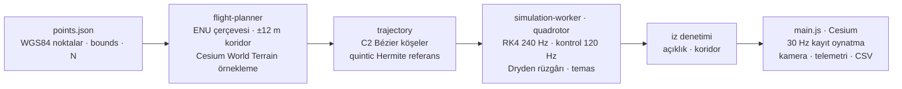

<div align="center">


# Uzungöl Drone Keşfi

**Gerçek arazi üzerinde, tarayıcıda çalışan 6 serbestlik dereceli quadrotor uçuş simülasyonu**

[](https://github.com/yucel-gumus/cesium-drone.github.io/actions/workflows/ci.yml)
[](https://cesium.com/platform/cesiumjs/)
[](https://nodejs.org/)
[](https://playwright.dev/)
[](https://yucel-gumus.github.io/cesium-drone.github.io/)

[**🌐 Canlı demo**](https://yucel-gumus.github.io/cesium-drone.github.io/) · [Hızlı başlangıç](#-hızlı-başlangıç) · [Nasıl çalışır](#-nasıl-çalışır) · [Fizik modeli](#️-fizik-modeli) · [Doğrulama](#-doğrulama)


</div>

Drone, Uzungöl'ün (Çaykara, Trabzon) gerçek arazi verisi üzerinde **motor hazırlığı → kalkış → eğrisel keşif → dönüş → yaklaşma → zemin teması → motor durdurma** görevini uçar. Konumu ve gövde açısı bir rota animasyonuna zorlanmaz: rota yalnızca kontrolcüye hedef verir; gerçek konum, hız, quaternion yönelimi, gövde açısal hızı ve dört motorun devri kuvvet ve tork denklemleriyle birlikte entegre edilir. Model, ölçümlerle tanımlanmış ticari bir drone değil, açık parametreli **genel 2 kg X quad**'dır.

## ✨ Öne çıkanlar

- 🧮 **Animasyon değil, fizik.** 240 Hz RK4 rijit cisim çözümü, 120 Hz SE(3) tipi yönelim kontrolü, motor gecikmesi, rotor jiroskopik momenti ve gerçek temas impulsuyla iniş.
- 🏔️ **Gerçek arazi.** Cesium World Terrain üzerinde ±12 m koridorda örnekleme; uçulan iz koridorun en yüksek zeminine göre yeniden denetlenir, açıklık bozulursa görev açılmaz.
- 🌬️ **Dryden türbülansı.** MIL-F-8785C düşük irtifa spektrumu, tohumlu ve bit düzeyinde tekrarlanabilir hamleler; tohum ve türbülans anahtarı arayüzden ayarlanır.
- 🎥 **Altı takip açısı, yapay ufuk, CSV.** Kamera drone'un yönüyle birlikte döner; telemetri ve 10 Hz uçuş kaydı aynı fizik çözümünden gelir.
- 🔁 **Deterministik.** Uçuş Web Worker içinde önceden çözülür ve 30 Hz kayıttan oynatılır; FPS, sekme hızı veya 1×/10× oynatma sonucu değiştirmez.
- ✅ **Doğrulanmış.** 30 birim testi, gerçek arazide 19 kontrollük Playwright regresyonu ve her push'ta çalışan GitHub Actions.

## 🚀 Hızlı başlangıç

Node.js **22.15+** ve Cesium World Terrain (asset 1) erişimli bir [Cesium ion](https://ion.cesium.com/) tokenı gerekir.

```sh
npm ci
cp .env.example .env      # CESIUM_ION_TOKEN=... satırını doldurun
npm start                 # http://localhost:9000
```

| Komut                    | Ne yapar                                                                 |
| ------------------------ | ------------------------------------------------------------------------ |
| `npm start`              | Webpack geliştirme sunucusu, kaynak değişince yeniden derler              |
| `npm run build`          | Üretim derlemesi `dist/` altına; GLB'den yazısız `drone.glb` üretir       |
| `npm run preview`        | `dist/` dizinini `http://127.0.0.1:9001/cesium-drone.github.io/` adresinde sunar |
| `npm test`               | 30 birim testi (Node yerleşik test runner)                               |
| `npm run verify:browser` | Playwright ile gerçek arazide 19 kontrollük tarayıcı regresyonu           |
| `npm run deploy`         | Üretim derlemesini `gh-pages` dalına yayınlar                            |

Token tarayıcıda kullanılır; Cesium ion üzerinden izinlerini ve alan adlarını kısıtlayın. `.env` Git'e girmez. Arayüzdeki **Harita erişim ayarı** bölümüne girilen alternatif token yalnızca sekme oturumunda saklanır. Cesium motoru, worker ve stiller aynı sabit **1.120.0** sürümünden paketlenir; arazi ve Esri uydu görüntüsü internet bağlantısı gerektirir.

## 🧭 Nasıl çalışır



1. **Rota** `public/points.json` dosyasından okunur, kalkış noktasına sabitlenmiş yerel ENU çerçevesine çevrilir ve köşeleri sıfır eğrilikli beşinci derece Bézier geçişlerle yuvarlatılır.
2. **Arazi** yuvarlatılmış yol boyunca en fazla 6 m aralıkla, merkez ve her iki yanda 12 m koridorla örneklenir. Keşif tavanı, koridordaki en yüksek zemin + seçilen açıklık + 10 m arazi / 5 m takip payıdır.
3. **Referans** eğrilikten hız sınırı türetir (`v ≤ √(a_lateral / |κ|)`), viraja önceden yavaşlayarak girer, konum/hız/ivme uç koşullarını paylaşan quintic Hermite bölümleriyle hız, ivme ve jerk sınırlarını korur.
4. **Fizik** Web Worker içinde tüm görevi sabit adımla çözer. Referans yalnızca kontrolcü hedefidir; viraj için gereken yanal kuvveti gerçek motor itkisiyle yatmış gövde üretir.
5. **Denetim** uçulan izin keşif ve dönüş fazlarındaki her kayıt noktasında açıklığı koridorun en yüksek örneklenmiş zeminine göre ölçer; açıklık veya koridor sınırı bozulmuşsa görev etkinleştirilmez.
6. **Oynatma** 30 Hz kaydı Cesium üzerinde quaternion ile render eder; rotor fazları da entegre edilmiş durumdan gelir.

Uçuş fazları sırasıyla `arming`, `takeoff`, `survey`, `return`, `settle`, `landing`, `touchdown`, `disarm` ve `complete`'tir.

## ⚙️ Fizik modeli

Referanslar: [PX4 kontrol mimarisi](https://docs.px4.io/main/en/flight_stack/controller_diagrams), [PX4 jerk sınırlı hedef üretimi](https://docs.px4.io/main/en/config_mc/mc_jerk_limited_type_trajectory), [SE(3) üzerinde quadrotor kontrolü](https://arxiv.org/abs/1003.2005) ve türbülans için MIL-F-8785C (*Flying Qualities of Piloted Airplanes*, 1980; Dryden spektrumunun düşük irtifa formu). Uygulama kendi kontrolcüsünü kullanır; **PX4 çalıştırmaz** ve PX4/SITL uyumluluğu iddia etmez.

**Koordinat ve birimler**

- Dünya: kalkış noktasına sabitlenmiş, sağ elli **ENU** (doğu, kuzey, yukarı), metre.
- Gövde: sağ elli **FLU** (ileri, sol, yukarı). Quaternion `w,x,y,z`, gövdeden ENU'ya; render sırasında ENU'dan ECEF'e çevrilir.
- Açısal hız rad/s, tork N·m, itki N, motor hızı rad/s; arayüzdeki RPM `ω × 60 / (2π)`.
- Motor sırası: ön sağ, arka sağ, arka sol, ön sol. Ön sağ ve arka sol saat yönünün tersine, ön sol ve arka sağ saat yönünde döner (`SPIN = [-1, 1, -1, 1]`, +1 üstten bakışta saat yönü; dönüş yönleri PX4 quad X dizilimiyle aynı, motor numaralandırması PX4'ten farklıdır). GLB rotor düğümleri `src/drone-model.mjs` içinde aynı sırayla eşlenir; konumları ve dönüş yönleri testle doğrulanır.

**Entegrasyon denklemleri**

```text
p_dot = v
m v_dot = R(q) [0, 0, Σf_i] + F_drag + [0, 0, -mg]
q_dot = 1/2 q ⊗ [0, Ω]
I Ω_dot = τ + τ_gyro + τ_reaction - Ω × (I Ω) - D_Ω Ω
τ        = Σ r_i × [0,0,f_i] + [0,0,Σ spin_i × reaction_ratio × f_i]
τ_gyro   = J_r × (Σ spin_i × ω_i) × [Ω_y, -Ω_x, 0]
τ_reaction = [0, 0, J_r × Σ spin_i × ω_i_dot]
ω_i_dot = (ω_cmd_i - ω_i) / motor_time_constant
f_i = k_f × (ρ / 1.225) × ω_i²
F_drag = -(1/2 ρ CdA |v - wind| + linear_drag) × (v - wind)
wind = mean_wind + [u, v, w]_Dryden        (her 240 Hz fizik adımında bir örnek)
```

Dört motor ayrı ayrı doygunluğa girer; komut değişince devir anında değil, motor zaman sabitiyle değişir. Rotor ataleti `J_r` ile rotorların spin momentumu `h = −J_r Σ spin_i ω_i e_z` gövde denklemine girer: `Σ spin_i ω_i ≠ 0` iken gövde açısal hızı jiroskopik tork, rotorların hızlanması ise z ekseninde reaksiyon torku üretir. İşaret kuralı reaksiyon torkuyla aynıdır: saat yönünde hızlanan rotor gövdeye +z tork verir; dengeli set ve durgun rotorlar iki terimi de sıfırlar.

**Kontrolcü.** RK4 integratör **240 Hz**, kontrolcü **120 Hz** çalışır. Konum/hız geri beslemesi, sınırlı integral, referans ivmesi, quaternion yönelim hatası, yönelim açısal hız ileri beslemesi ve gövde açısal hız geri beslemesi kullanır. Euler çaprazlama terimi gibi rotor jiroskopik torku da ideal durum bilgisi varsayımıyla tork komutunda kompanse edilir; rotor hızlanma reaksiyonu kompanse edilmez. Yaw hedefinin açısal hızı ve ivmesi sınırlıdır. Kontrolcü komutları limitlidir; fizik çözümünün gerçek sonucu referansa kopyalanmaz.

**Varsayılan genel profil**

| Parametre                                | Değer                                                              |
| ---------------------------------------- | ------------------------------------------------------------------ |
| Kütle                                    | 2 kg; arayüzde 1–3 kg                                              |
| Atalet Ixx / Iyy / Izz                   | 0,035 / 0,035 / 0,060 kg·m²                                        |
| Merkez–motor kolu                        | 0,25 m                                                             |
| İtki katsayısı, 1,225 kg/m³ referansında | 1,8 × 10⁻⁵ N/(rad/s)²                                              |
| Reaksiyon torku / itki                   | 0,018 m                                                            |
| Rotor devir sınırı                       | 850 rad/s ≈ 8.117 rpm                                              |
| Motor zaman sabiti                       | 55 ms                                                              |
| Rotor ataleti J_r                        | 6 × 10⁻⁵ kg·m²; ölçülmemiş genel tahmin                            |
| Sabit hava yoğunluğu                     | 1,09 kg/m³; bölge yüksekliği için yaklaşık varsayım                |
| CdA / doğrusal sürükleme                 | 0,08 m² / 0,10 N·s/m                                               |
| Yatış komut sınırı                       | 25°                                                                |
| Yaw komut hızı / ivmesi                  | 40°/s / 60°/s²                                                     |
| Ortalama rüzgâr W                        | 2 m/s; arayüzde 0–3,5 m/s (2 kg profilin yetki sınırı)             |
| Türbülans şiddeti σ_u = σ_v / σ_w        | 0,141 W / 0,1 W; W = 2 m/s için 0,28 / 0,20 m/s                    |
| Türbülans ölçek uzunluğu L_u = L_v / L_w | 256 m / 91 m; sabit 300 ft temsilî irtifa                          |
| Türbülans tohumu / anahtarı              | arayüzde **Tohum** = 1 / **Türbülans** açık (`seed`, `turbulence`) |

Kütle değiştirildiğinde sabit geometrili genel araç varsayımıyla atalet de kütleyle orantılı ölçeklenir; rotor ataleti ölçeklenmez.

<details>
<summary><strong>Rüzgâr ve Dryden türbülansı</strong></summary>

Rüzgâr, doğu-kuzeydoğu yönünde (doğu:kuzey = 1:0,4) sabit **ortalama rüzgâr** ile MIL-F-8785C düşük irtifa **Dryden türbülansının** toplamıdır. Arayüzdeki hız `W` spesifikasyondaki 20 ft rüzgârı olarak alınır: `σ_w = 0,1 W`, `σ_u = σ_v = σ_w / g^0,4`, `L_w = h`, `L_u = L_v = h / g^1,2`, `g = 0,177 + 0,000823 h` (h feet, 10–1000 ft'e kırpılır). Ölçek uzunlukları gerçek AGL yerine sabit 300 ft (91 m) temsilî irtifayla hesaplanır.

Boyuna bileşen birinci derece filtrenin tam Ornstein–Uhlenbeck adımıyla, yanal ve dikey bileşenler ikinci derece Dryden filtresinin tam sıfırıncı dereceden tutma ayrıklaştırmasıyla (durağan kovaryans her hızda korunur, genlik sıçraması olmaz) her 240 Hz fizik adımında bir kez ilerletilir. Donmuş alan hipotezi gereği filtre hızı aracın hava-göreli hızıdır ve dört RK4 alt adımı aynı rüzgâr örneğini görür. Filtre durumları durağan dağılımdan başlar, ısınma gerekmez.

Gürültü mulberry32 + Box–Muller ile üretilir ve tohumludur: `simulate(reference, { wind, seed, turbulence })` içinde `seed` (varsayılan 1) aynı girdiyle bit düzeyinde aynı hamle dizisini verir, `turbulence: false` yalnızca ortalama rüzgârı uygular; sonuç nesnesi `wind` yanında `seed` ve `turbulence` alanlarını da taşır. Arayüzdeki **Tohum** ve **Türbülans** alanları bu seçenekleri worker'a `{ airframe, wind, seed, turbulence }` olarak geçirir. Kayıt ve CSV'deki rüzgâr sütunları o adımda uygulanan anlık ENU rüzgârıdır. Dryden spektrumu standart bir mühendislik modelidir; bölgeye ait ölçülmüş meteoroloji verisi değildir.

</details>

<details>
<summary><strong>Rüzgâr yetki sınırı: arayüz neden 3,5 m/s'de durur</strong></summary>

Kontrolcünün yatay ivme komutu 4 m/s² ve 25° yatışla sınırlıdır. 8 m/s seyrin karşı rüzgâr bacağında gereken sürükleme ivmesi `(½ ρ CdA V² + c_lin V) / m`, `V = 8 + W`; 2 kg profil için bu talep W = 3,5 m/s'de 3,5 m/s² (%87), W = 4 m/s'de 3,7 m/s² (%93), W ≈ 4,45 m/s'de tam 4 m/s²'dir ve tipik bir 2σ_u hamlesi eklendiğinde sınır zaten W ≈ 3,5 m/s'de aşılır. Node üzerinde düz 1150 m arazi ve tam Uzungöl göreviyle (2 kg, türbülans açık) ölçülen azami takip hatası:

| W (m/s) | Azami takip hatası                                          |
| ------- | ----------------------------------------------------------- |
| 2       | ≈ 0,65 m                                                    |
| 3,5     | 40 tohumun tamamı ≤ 0,86 m; medyan 0,70 m, iniş hatası ≤ 4,1 cm |
| 4       | 40 tohumdan 8'i > 1 m; en kötü 5,3 m                        |
| 4,5     | 8 tohumun 6'sı > 1 m; medyan 2,6 m, en kötü 17 m            |
| 5       | medyan 16 m; iz koridor denetimini geçemeyebilir             |

Arayüzün üst sınırı bu yüzden **3,5 m/s**'dir: 1 m altı takip hatasının tohumdan bağımsız sağlandığı en yüksek 0,5 m/s adımı. Sürükleme alanı kütleyle ölçeklenmediğinden yetki kütleye bağlıdır: 2,5–3 kg 5 m/s'de bile ≤ 0,7 m kalır; 1,8–1,9 kg 3,5 m/s'de ≤ 0,85 m tutar; 1,6–1,7 kg 3 m/s'ye kadar ≤ 0,92 m, 3,5 m/s'de 2–17 m; 1,5 kg 2 m/s'ye kadar ≤ 0,9 m, 3 m/s'de 24 m'ye çıkar; 1 kg ise durgun havada bile ≈ 1,1 m hata verir ve 1,5 m/s'den itibaren iz koridoru aşar. Böyle bir çözüm `Dinamik uçuş arazi açıklığı/koridor denetimini geçemedi.` hatasıyla etkinleştirilmez; kütleye bağlı bir rüzgâr sınırı henüz uygulanmaz.

</details>

<details>
<summary><strong>Drone modeli</strong></summary>

Derleme, kaynak `CesiumDrone.glb` dosyasından yazısız `drone.glb` üretir: `scripts/clean-drone-model.cjs` üst gövdedeki yazı ve simge bölgesinin üçgenlerini UV sınırlarında böler ve yalnızca bu bölgeyi aynı kaplamanın yazısız gövde dokusuna eşler; renk, normal ve ORM kanallarındaki marka izi birlikte kalkar, kaynak dosya ve rotor düğümleri korunur. Kameraya göre modeli büyüten `minimumPixelSize` kaldırılmıştır; GLB motor aralığı fizik profilinin kol uzunluğuna göre ölçeklenir. Modelin taban plakası CG zemin ofseti kadar aşağı kaydırılır: yerde dururken gövde pad üzerine oturur, varlık konumu ise fiziksel CG olarak kalır.

</details>

## 🛤️ Rota, arazi ve iniş

**Rota dosyası** `public/points.json` bölgeden bağımsızdır: `name`, `coordinateSystem`, `altitudeMode`, 3–200 `dronePoints` (`longitude`, `latitude`, derece), zorunlu `bounds` (`west`, `east`, `south`, `north`) ve isteğe bağlı `geoidUndulation` (metre) / `geoidSource` (yalnızca belge amaçlı) alanlarını içerir. Planlayıcı `bounds` için `west < east`, `south < north`, geçerli derece aralıkları ve en fazla **0,5° × 0,5°** kutu ister (tek kalkış noktasına bağlı ENU teğet düzlemi için; antimeridyen üzerinden sarılan kutular desteklenmez). Her nokta kutunun içinde olmalıdır, aksi halde `Rota noktası N: rota sınırlarının dışında.` hatası verilir. Başka bir bölge için rota dosyasını değiştirmek yeterlidir; arayüz başlıkları ise hâlâ Uzungöl'ü anlatır.

**Referans sınırları:** yer hızı **8 m/s**, tırmanma **2,5 m/s**, alçalma **1,5 m/s**, yatay ivme **1,5 m/s²**, viraj yanal ivmesi **1,2 m/s²**, jerk **2 m/s³**. Bunlar hedef üretim sınırlarıdır; kapalı çevrimdeki gerçek değerler küçük takip sapmaları gösterebilir ve ölçülür. Tam 180° geri dönüş gibi tekil rota geometrileri reddedilir.

**Yükseklik tanımları**

- **AGL:** gerçek ENU konumunun, yakın merkez çizgi zemin profiliyle farkı.
- **Elipsoit irtifası:** gerçek ECEF konumunun WGS84 yüksekliği. Cesium World Terrain ve uygulamadaki bütün yükseklikler elipsoide göredir, **MSL değildir**.
- **Yaklaşık MSL irtifası:** elipsoit irtifası − N; N rota dosyasındaki `geoidUndulation`. Uzungöl için **N = 27,2621 m** (EGM96), [GeographicLib GeoidEval](https://geographiclib.sourceforge.io/cgi-bin/GeoidEval?input=40.618+40.298) ile 40,618° K / 40,298° D noktasında 2026-10-17 tarihinde hesaplanmıştır; aynı noktada EGM2008 30,0493 m verir. Tek bir sabit olduğu için ~5 km'lik rota içinde birkaç desimetre sapabilir, |N| > 120 m reddedilir, kalibre bir ölçüm değildir ve CSV'ye yazılmaz. Rota dosyasında N yoksa metrik `—` gösterir.
- **Kalkışa göre:** elipsoit yüksekliği − kalkış zemininin yüksekliği.

AGL, örneklenmiş zemin profilinin interpolasyonudur; harita DEM'inin gerçek dünya doğruluğuna dair bir garanti değildir. Kullanıcı açıklığı **30–150 m** arasında seçebilir; arazi örneği eksikse uçuş açılmaz.

**İniş.** Drone önce kalkışın üstünde frenler, yaklaşır, son 3 metrede yavaşlar. Kalkış alanı düz ve rijit bir temas düzlemidir: normal impuls ile kayma/statik sürtünme uygulanır, CG için 0,10 m zemin ofseti kullanılır. Motorlar yalnızca ölçülen temas, düşük hız ve konum koşulları sağlanınca kademeli kapatılır. **XY konumu eve kopyalanmaz**; santimetre düzeyindeki son hata raporda kalır.

## 🎮 Kullanım

<div align="center">

</div>

- **Rotayı hesapla:** açıklık, kütle, rüzgâr, tohum ve türbülans ayarlarıyla bütün fizik deneyini yeniden çözer. Aynı rota ve token için arazi örnekleri sekme içinde yeniden kullanılır; yeniden planlama bir saniyenin altında biter. Alanlar hesap ve uçuş sırasında kilitlenir.
- **Başlat / Duraklat / Başa al** ve zaman çubuğu aynı fizik kaydını kullanır. Duraklatıldığında telemetri dondurulan andaki gerçek hızı gösterir; yapay olarak sıfırlanmaz. Oynatma 1×, 2×, 5× veya 10×.
- **Rota / Drone takibi:** takip kamerası ENU çerçevesinde yumuşatılmış yön takibiyle çalışır. Fare tekerleği, iki parmak veya sürgü ile **1,2–80 m** aralığında yakınlaşılır; mesafe kamera ve uçuş geçişlerinde korunur.
- **Altı takip açısı:** arkadan, önden, sol, sağ, üstten ve çapraz. Açılar drone'un yönüne göredir ve drone döndükçe birlikte döner; geçişler yumuşaktır.
- **Telemetri:** AGL, yer hızı, elipsoit ve yaklaşık MSL irtifası, kalkışa göre yükseklik, dikey hız, yön, yatış, tangaj, gövde açısal hızı, toplam itki, takip hatası, anlık rüzgâr ve dört motorun RPM'i. Yapay ufuk gerçek quaternion'dan çizilir.
- **Harita:** yeşil çizgi referans, turkuaz çizgi son 120 saniyenin gerçekleşen izidir. Kalkış etiketi kameraya 6 m'den yakınken gizlenir. Dokunmatik cihazlarda arazi detay eşiği 2, fare/trackpad cihazlarda 1,5'tir.
- **Fizik modeli ve uçuş doğrulaması** bölümü parametreleri, ortalama rüzgârı, tohumu, takip ve iniş hatasını, temas hızını ve motor doygunluğunu gösterir.
- **CSV:** 30 Hz kayıttan 10 Hz örnek indirir; zaman, ENU konumu/hızı, quaternion, gövde hızları, ivme, motor rad/s, itki/tork, anlık rüzgâr, kat edilen mesafe, takip hatası, faz kodu ve motor doygunluğu bayrağı (32 sütun). Faz sırası `quadrotor.mjs` içindeki `PHASE_NAMES` ile aynıdır; ENU orijini kalkışın CG konumudur.

Uçuş ortasında manuel kumanda veya canlı fizik girdisi yoktur.

## ✅ Doğrulama

| Katman                 | Kapsam                                                                                                                                                                                                   |
| ---------------------- | -------------------------------------------------------------------------------------------------------------------------------------------------------------------------------------------------------- |
| `npm test` · 30 test   | Analitik serbest düşüş, dengeli hover, yatık itki, motor gecikmesi, tork dağılımı, enerji korunumu, RK4 yakınsaması, Dryden ayrıklaştırma kimliği ve istatistikleri, jiroskopik/reaksiyon torku, tam Uzungöl görevi, koridor açıklığı, GLB rotor eşlemesi, `bounds` ve MSL |
| `npm run verify:browser` · 19 kontrol | Playwright ile gerçek arazide: worker, 289 bağımsız arazi sorgusu, CSV, tüm uçuş ve iniş, altı kamera açısı, zoom, yeniden planlama, türbülans kontrolleri, 390 px mobil yerleşim, token hata/kurtarma, ağ hataları |
| GitHub Actions         | Her push ve pull request'te Node 22 ile `npm ci`, `npm test`, `npm run build`; `dist/` 7 gün artifact olarak saklanır. Token gerektirmez                                                                 |

```sh
npm test
npx playwright install chromium   # bir kez
npm run build && npm run preview  # ayrı terminalde dist/ sunar
npm run verify:browser            # PREVIEW_URL ile başka adres verilebilir
```

Tarayıcı regresyonu sunucu başlatmaz ve yalnızca sunulan `dist/` derlemesini doğrular. Rapor `artifacts/browser-verification.json`, ekran görüntüleri `artifacts/` altındadır; tokenlar rapora yazılmaz. Yalnızca geçersiz token denemesindeki beklenen 401 kabul edilir, başka bir ağ hatası testi düşürür. Türbülans kontrolleri denetimi hariç aynı 18 kontrol, Kimi Browser Extension köprüsüyle `node scripts/verify-browser.mjs` üzerinden de çalıştırılabilir. Gerçek token ve ağ gerektirdiğinden tarayıcı regresyonu CI'da çalışmaz.

## 📏 Doğruluk sınırları

Bu, kinematik animasyondan gerçek kuvvet/tork entegrasyonuna geçirilmiş bir simülasyon çekirdeğidir. **Sertifikalı veya uçuş verisiyle doğrulanmış bir eğitim/FDM ürünü değildir.** Gerçek bir drone'a yakınlık için kütle/CG/atalet ölçümleri, pervane itki-tork testleri, motor/ESC tanımlaması ve gerçek uçuş kayıtlarıyla doğrulama gerekir.

Korunan varsayımlar: ideal ve gecikmesiz durum bilgisi; sabit yerçekimi ve hava yoğunluğu; tek rijit gövde; karesel rotor itkisi; ölçülmemiş genel rotor ataleti; basitleştirilmiş sürükleme; noktasal düz pad teması; sabit temsilî irtifaya göre Dryden ölçekleri; tek sabit jeoit ondülasyonu. Blade flapping, ground effect, downwash/vortex ring, pil/ESC gerilim düşümü, sensör gürültüsü/EKF, Coriolis ve bina/ağaç/elektrik hattı çarpışmaları modellenmez. DEM güncel bir engel haritası değildir. Gerçek drone'a komut gönderilmez.

## 🗺️ Yol haritası

- Kütleye bağlı rüzgâr yetki sınırı
- Ground effect, blade flapping ve downwash
- Sensör gürültüsü ve durum kestirimi (EKF)
- Esnek iniş takımı, çoklu ayak teması ve eğimli zemin
- Bina/ağaç engel haritası
- Gerçek uçuş kayıtlarıyla kalibrasyon

## 📁 Dosya yapısı

```text
src/flight-math.mjs            Vektör/quaternion ve Hermite matematiği
src/trajectory.mjs             C2 köşe geçişleri ve sınırlandırılmış referans
src/quadrotor.mjs              Rijit cisim, Dryden rüzgârı, kontrol, RK4, temas
src/simulation-worker.mjs      Ana UI'yi kilitlemeden fizik çözümü
src/flight-planner.mjs         WGS84/ENU, bounds, koridor, iz denetimi, MSL
src/drone-model.mjs            GLB rotor düğümleri, model ölçeği ve zemin ofseti
src/position-property.mjs      Cesium 1.120 için CallbackPositionProperty eşleniği
src/main.js                    Harita, quaternion render, rotorlar, kamera, CSV
src/ui-controller.js           Gerçek durum telemetrisi ve yapay ufuk
src/index.html, src/style.css  Türkçe arayüz ve stiller
public/points.json             Keşif noktaları, bounds, jeoit ondülasyonu N
tests/*.test.mjs               Node test runner: fizik, planlayıcı, GLB düğümleri
scripts/clean-drone-model.cjs  Derlemede CesiumDrone.glb → yazısız drone.glb
scripts/serve-preview.mjs      npm run preview: dist/ için statik sunucu (9001)
scripts/verify-playwright.mjs  Playwright tarayıcı/terrain regresyonu (birincil)
scripts/verify-browser.mjs     Aynı regresyonun 18 kontrolü, Kimi Browser Extension köprüsüyle
.github/workflows/ci.yml       GitHub Actions: test, build, dist artifact
docs/                          README ekran görüntüleri
```

## 📦 Yayınlama

`npm run deploy` üretim derlemesini geçmişi koruyarak `gh-pages` dalına gönderir ve `.nojekyll` ekler; GitHub Pages kaynağı `gh-pages` / `/` olmalıdır. Token derleme ortamında tanımlı olmalıdır; yalnızca tarayıcı kullanımı için hazırlanmış, okuma yetkili ve alan adı kısıtlamalı bir Cesium ion tokenı kullanın. GitHub kimlik doğrulaması sistem anahtarlığı üzerinden yapılmalı; erişim anahtarını uzak depo adresine yazmayın.

## 👤 Geliştirici

[Yücel Gümüş](https://www.yucelgumus.dev/)
