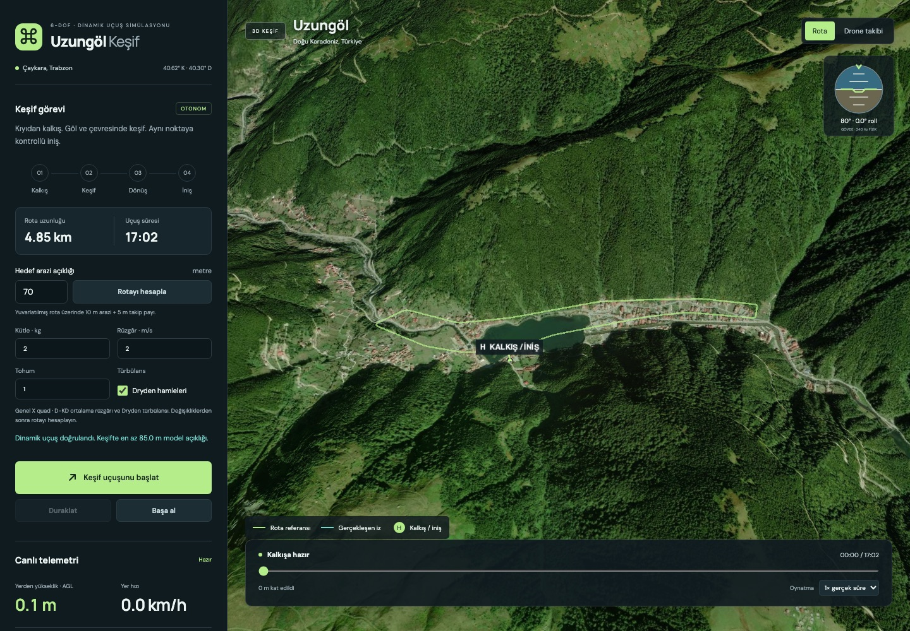
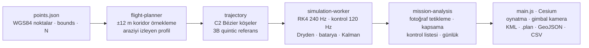
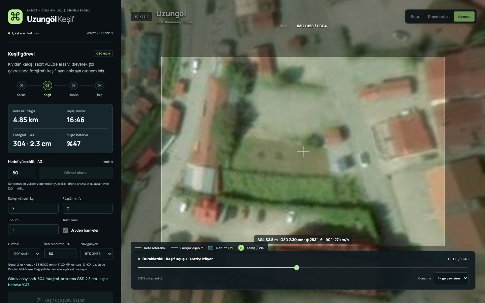
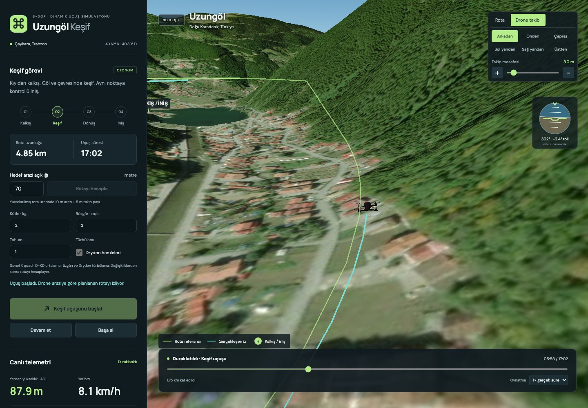

<div align="center">


# Uzungöl Drone Keşfi

**Gerçek arazi üzerinde, tarayıcıda çalışan profesyonel quadrotor keşif uçuşu simülasyonu**

[](https://github.com/yucel-gumus/cesium-drone.github.io/actions/workflows/ci.yml)
[](https://cesium.com/platform/cesiumjs/)
[](https://nodejs.org/)
[](https://playwright.dev/)
[](https://yucel-gumus.github.io/cesium-drone.github.io/)

[**🌐 Canlı demo**](https://yucel-gumus.github.io/cesium-drone.github.io/) · [Hızlı başlangıç](#-hızlı-başlangıç) · [Görev akışı](#-görev-akışı) · [Kamera yükü](#-kamera-yükü) · [Enerji](#-enerji) · [Navigasyon](#️-navigasyon) · [Doğrulama](#-doğrulama)



</div>

Bir operatörün sahada yürüttüğü keşif görevini uçtan uca modeller: görev planlanır, **uçuş öncesi kontrol listesinden** geçer, drone Uzungöl'ün (Çaykara, Trabzon) gerçek arazisi üzerinde **sabit AGL'de araziyi izleyerek** uçar, kamera mesafeye göre fotoğraf çeker, batarya rezerviyle eve döner ve **iniş dedektörüyle** motorlarını durdurur. Uçuş bir animasyon değil: 240 Hz'de çözülen 6 serbestlik dereceli rijit cisim dinamiğidir ve kontrolcü gerçek durumu değil, **RTK GNSS + IMU + barometre füzyonuyla kestirilen** durumu kullanır. Görev sonunda plan ve kayıt KML, QGroundControl `.plan`, GeoJSON ve CSV olarak dışa aktarılır.

Model, ölçümlerle tanımlanmış ticari bir drone değil; açık parametreli **genel 2 kg X quad**, genel 6S LiPo batarya ve genel 1″ 20 MP haritalama kamerasıdır.

## ✨ Öne çıkanlar

- 🏔️ **Araziyi izleyen uçuş.** Koridorun en yüksek zemininden sabit yükseklikte, tırmanma ve alçalma hızı sınırlı, önceden yükselen yumuşak bir dikey profil. Yasal **120 m AGL** tavanı denetlenir.
- 📷 **Kamera yükü.** Gerçek sensör geometrisiyle GSD, %80 ileri bindirme için mesafe tabanlı tetikleme, araziye düşen görüntü izleri ve drone kamerasından **canlı gimbal görünümü**.
- 🔋 **Enerji modeli.** Rotor torkundan elektrik gücü, LiPo gerilim eğrisi ve iç direnç, gerilim düşümüyle azalan motor yetkisi, **%25 iniş rezervi**.
- 🛰️ **Navigasyon.** Kalman filtresi; RTK ile santimetre, standart GNSS ile metre düzeyinde gerçekçi kestirim hatası. PX4 tarzı iniş dedektörü.
- ✅ **Uçuş öncesi kontrol listesi.** On iki madde; engelleyici bir madde düşerse görev uçurulamaz ama incelenebilir.
- 📤 **Standart çıktılar.** KML (deniz seviyesine göre), QGroundControl `.plan` (MAVLink komutlarıyla), GeoJSON (RFC 7946) ve 40 sütunlu CSV.
- 🔁 **Deterministik ve doğrulanmış.** Aynı girdi bit düzeyinde aynı uçuşu verir. 45 birim testi, gerçek arazide 23 kontrollük Playwright regresyonu, her push'ta GitHub Actions.

## 🚀 Hızlı başlangıç

Node.js **22.15+** ve Cesium World Terrain (asset 1) erişimli bir [Cesium ion](https://ion.cesium.com/) tokenı gerekir.

```sh
npm ci
cp .env.example .env      # CESIUM_ION_TOKEN=... satırını doldurun
npm start                 # http://localhost:9000
```

| Komut                    | Ne yapar                                                                         |
| ------------------------ | -------------------------------------------------------------------------------- |
| `npm start`              | Webpack geliştirme sunucusu, kaynak değişince yeniden derler                      |
| `npm run build`          | Üretim derlemesi `dist/` altına; GLB'den yazısız `drone.glb` üretir               |
| `npm run preview`        | `dist/` dizinini `http://127.0.0.1:9001/cesium-drone.github.io/` adresinde sunar |
| `npm test`               | 45 birim testi (Node yerleşik test runner)                                       |
| `npm run verify:browser` | Playwright ile gerçek arazide 23 kontrollük tarayıcı regresyonu                   |
| `npm run deploy`         | Üretim derlemesini `gh-pages` dalına yayınlar                                    |

Token tarayıcıda kullanılır; Cesium ion üzerinden izinlerini ve alan adlarını kısıtlayın. `.env` Git'e girmez. Arayüzdeki **Harita erişim ayarı** bölümüne girilen alternatif token yalnızca sekme oturumunda saklanır.

## 🧭 Görev akışı



Operatör açısından akış şöyledir:

1. **Planla.** Hedef AGL, kalkış kütlesi, rüzgâr, gimbal açısı, ileri bindirme ve navigasyon kalitesi seçilir; **Görevi planla** arazi koridorunu örnekler ve bütün uçuşu Web Worker içinde çözer. Aynı rota ve token için arazi örnekleri yeniden kullanılır, yeniden planlama bir saniyenin altında biter.
2. **Kontrol et.** Uçulan iz araziye, yasal tavana, coğrafi sınıra, bataryaya ve motor yetkisine karşı denetlenir. Engelleyici bir madde düşerse başlat düğmesi kilitlenir; plan zaman çubuğuyla yine incelenebilir.
3. **Uç.** Görev 30 Hz kayıttan oynatılır. **Rota**, **Drone takibi** (altı açı) ve **Kamera** görünümleri arasında geçilir; telemetri, batarya göstergesi ve uçuş günlüğü canlı izlenir.
4. **Teslim et.** Plan ve kayıt dört standart formatta dışa aktarılır.

Uçuş fazları sırasıyla `arming`, `takeoff`, `survey`, `return`, `settle`, `landing`, `touchdown`, `disarm` ve `complete`'tir.

## 🏔️ Araziyi izleyen uçuş

Profesyonel keşif sabit tavanda değil sabit yerden yükseklikte uçar: görüntü çözünürlüğü ve kapsama yere olan mesafeye bağlıdır. Rota en fazla 6 m aralıkla, merkez ve her iki yanda ±12 m koridorla Cesium World Terrain üzerinden örneklenir. Her rota düğümü için gereksinim, o kesitteki en yüksek zemin artı hedef AGL'dir. Dikey profil üç adımda kurulur:

1. **Genişletme.** Gereksinim ±40 m boyunca en büyük değere genişletilir: drone sırttan önce tırmanır, sonra alçalır.
2. **Eğim sınırı.** Seyir hızında 3 m/s tırmanma ve 2,5 m/s alçalmayı aşmayacak şekilde yalnızca yükseltilir; açıklık hiçbir yerde azaltılmaz.
3. **Yumuşatma.** Desteği genişletme penceresinin içinde kalan (3σ = 36 m ≤ 40 m) Gauss çekirdeği uygulanır.

Genişletilmiş ve yalnızca yükseltilmiş bir diziyi pencereden dar bir çekirdekle ortalamak, her noktayı kendi gereksiniminin üstünde tutar ve eğimi artıramaz. Profil, yatay hız planıyla aynı quintic parçalara üçüncü eksen olarak girer: konum, hız ve ivme üç eksende süreklidir; dikey ivme 1 m/s², jerk 2 m/s³ ile sınırlıdır. Uçuş sonrası denetim, uçulan izin keşif ve dönüş fazlarındaki açıklığını koridor zeminine göre, uçuş boyunca en yüksek AGL'yi ise hemen alttaki zemine göre ölçer.

Gerçek Uzungöl arazisinde varsayılan 80 m hedefle ölçülen değerler:

| Ölçüm                           | Değer   |
| ------------------------------- | ------- |
| Koridor zeminine en düşük açıklık | 80,0 m  |
| En yüksek AGL                   | 99,8 m  |
| Azami takip hatası              | 0,63 m  |
| Uçuş süresi                     | 16:46   |

Hedef AGL 110 m seçilirse vadi üzerinde 129,8 m'ye çıkılır ve **yasal irtifa tavanı** maddesi planı engeller. Kalkış ve iniş bölgesinde AGL, hemen alttaki zemine göre ölçülür; elipsoit, yaklaşık MSL ve kalkışa göre yükseklik ayrıca gösterilir.

## 📷 Kamera yükü

<div align="center">

</div>

| Parametre               | Değer                                           |
| ----------------------- | ----------------------------------------------- |
| Sensör                  | 1″, 13,2 × 8,8 mm, 5472 × 3648 piksel (20 MP)   |
| Odak uzaklığı           | 8,8 mm · görüş açısı 73,7° × 53,1°              |
| Pozlama / asgari aralık | 1/1000 s / 0,7 s                                |
| Gimbal                  | 3 eksen stabilize; −90° nadir, −70°, −60°, −45° |
| Görüntü yönü            | Uzun kenar uçuş yönüne dik                      |

- **GSD** (yer örnekleme aralığı) optik eksen boyunca eğik mesafeden hesaplanır: `GSD = mesafe × sensör genişliği / (odak × görüntü genişliği)`. 80 m'de nadir görüntüde 2,19 cm/piksel.
- **Tetik aralığı**, planlanan AGL'deki uçuş yönündeki iz uzunluğunun `1 − bindirme` katıdır; görev planlayıcıların `MAV_CMD_DO_SET_CAM_TRIGG_DIST` ile kullandığı mesafe tabanlı tetiklemedir. 80 m ve %80 bindirmede 16 m.
- Uçulan iz yeniden oynatılır ve kamera her tetik mesafesinde gerçek konum ve yönelimle ateşlenir. Her karenin dört köşe ışını yere düşürülerek **görüntü izi** hesaplanır; izler haritada çekildikleri anda belirir.
- **Kamera** görünümü Cesium kamerasını drone'un konumuna, gövde yönüne ve gimbal eğimine yerleştirir, sensörün görüş açısını uygular, drone modelini ve plan katmanlarını gizler. HUD fotoğraf sayacını, çekim anında yanan REC işaretini, AGL'yi ve anlık GSD'yi gösterir. Uydu görüntüsü Uzungöl'de mevcut en ince seviye olan 18'e (yaklaşık 0,45 m/piksel) kadar açılır.

Gerçek arazide ölçülen kapsama:

| Ayar                | Kare | Ortalama GSD | Tetik  | Asgari bindirme | Hareket bulanıklığı |
| ------------------- | ---- | ------------ | ------ | --------------- | ------------------- |
| 80 m, −90°, %80     | 304  | 2,29 cm      | 16,0 m | %80             | 0,34 piksel         |
| 60 m, −90°, %80     | 405  | 1,75 cm      | 12,0 m | %80             | 0,45 piksel         |
| 80 m, −45°, %80     | 114  | 3,24 cm      | 42,7 m | %80             | 0,24 piksel         |

## 🔋 Enerji

Her fizik adımında dört rotorun mil gücü `Σ κ f_i ω_i` (κ: reaksiyon torku / itki) hesaplanır, itki zinciri verimiyle elektrik gücüne çevrilir ve aviyonik yük eklenir. Paket Thevenin modeliyle çözülür: açık devre gerilimi şarj durumuna bağlı LiPo eğrisinden gelir, `P = V I` ve `V = E − I R` birlikte çözülür, şarj Coulomb sayımıyla düşer. Fırçasız motor devri gerilimle ölçeklendiğinden, **düşen gerilim azami rotor devrini ve kontrol yetkisini azaltır**.

| Parametre                  | Değer                               |
| -------------------------- | ----------------------------------- |
| Paket                      | 6S LiPo, 6000 mAh, yaklaşık 133 Wh  |
| İç direnç                  | 30 mΩ                               |
| İtki zinciri verimi        | %78 (ESC × motor)                   |
| Aviyonik + gimbal kamera   | 18 W                                |
| İniş rezervi               | %25                                 |
| Asgari hücre gerilimi      | 3,3 V (paket 19,8 V)                |

Gerçek arazide, 80 m hedefle, kalkış kütlesine göre ölçülen sonuçlar:

| Kalkış kütlesi | Keşif gücü | Enerji   | İnişte batarya | Kontrol listesi                                     |
| -------------- | ---------- | -------- | -------------- | --------------------------------------------------- |
| 1,5 kg         | 186 W      | 51,0 Wh  | %64            | geçti                                               |
| 2 kg           | 273 W      | 75,2 Wh  | %47            | geçti                                               |
| 2,5 kg         | 372 W      | 102,6 Wh | %26            | geçti, rezervin hemen üstünde                       |
| 3 kg           | 482 W      | 133,2 Wh | %1             | engellendi: rezerv, gerilim, motor yetkisi           |

3 kg'da zincirleme etki gerçekçidir: paket 19,3 V'a düşer, azalan devir sınırı 34 saniye motor doygunluğuna yol açar, takip hatası 5,9 m'ye ve temas hızı 1,2 m/s'ye çıkar.

## 🛰️ Navigasyon

Kontrolcü konum ve hızı her eksende ayrı çalışan üç durumlu bir Kalman filtresinden alır: durum konum, hız ve ivmeölçer sapmasıdır. İvmeölçer tahmini 120 Hz'de ilerletir; GNSS konum ve hızı 10 Hz'de, barometre 40 Hz'de düzeltir. Filtre ilk GNSS fix'iyle başlar. GNSS hatası hızlı beyaz gürültüye ek olarak yavaş gezinen, üstel korelasyonlu bir sapma içerir; gerçek alıcılar titremekten çok kayar. Raporlanan konum belirsizliği, filtre varyansına ortalamayla silinemeyen bu sapmayı da ekler.

| Sensör            | RTK GNSS                          | Standart GNSS                    |
| ----------------- | --------------------------------- | -------------------------------- |
| Yatay beyaz / kayma | 0,8 cm / 1 cm (60 s)             | 25 cm / 70 cm (40 s)             |
| Dikey beyaz / kayma | 1,5 cm / 2 cm                    | 50 cm / 1,2 m                    |
| Hız gürültüsü     | 2 cm/s                            | 8 cm/s                           |
| Uydu · HDOP       | 24 · 0,6                          | 16 · 0,9                         |
| Gerçek arazide azami kestirim hatası | 0,06 m          | 1,95 m                           |
| Gerçek arazide iniş hatası           | 0,03 m          | 1,52 m                           |

İvmeölçer 0,03 m/s² gürültü, 0,03 m/s² başlangıç sapması ve yavaş sapma yürüyüşü taşır; barometre 8 cm gürültü ve 40 cm hava/sıcaklık kayması taşır. Yönelim ideal AHRS'ten gelir. Sensör gürültüsü ayrı bir rastgele sayı akışından üretilir, türbülans dizisini değiştirmez.

**Kalkış.** Motor hazırlığı sırasında yatay düzeltme ve integral birikimi yoktur; pad üzerindeki iniş takımı gövdeyi düz tutar. Kalkış, PX4'teki gibi navigasyonun o anki kestirimine sabitlenir: kestirim ile plan arasındaki yatay fark tırmanış boyunca yumuşakça sıfıra indirilir. Böylece standart GNSS'in metre düzeyindeki ilk ofseti drone'u pad'den yana savurmaz, görev başında referans süreklidir.

**İniş dedektörü.** Eve dönüşte drone ev noktası üzerinde konum tutar, 3 m sürünme irtifasına alçalır ve 0,35 m/s sabit hızla iner; referans pad'in altına devam eder ki kestirim hatası drone'u havada asılı bırakmasın. Motorlar, kontrolcünün istediği toplam itki askı itkisinin %80'inin altına düşüp hız 0,3 saniye boyunca sıfıra yakın kaldığında durur; temas ile motor kesme arasındaki süre iki saniyenin altındadır. Mutlak yükseklik veya ev konumu kullanılmaz; standart GNSS ile de çalışır. Filtre ivmeölçeri delta-hız olarak, her kontrol aralığının ortalama ivmesiyle alır; temas darbesi kaybolmaz veya iki kez sayılmaz.

## ⚙️ Fizik modeli

Referanslar: [PX4 kontrol mimarisi](https://docs.px4.io/main/en/flight_stack/controller_diagrams), [PX4 jerk sınırlı hedef üretimi](https://docs.px4.io/main/en/config_mc/mc_jerk_limited_type_trajectory), [SE(3) üzerinde quadrotor kontrolü](https://arxiv.org/abs/1003.2005) ve türbülans için MIL-F-8785C (*Flying Qualities of Piloted Airplanes*, 1980; Dryden spektrumunun düşük irtifa formu). Uygulama kendi kontrolcüsünü kullanır; **PX4 çalıştırmaz** ve PX4/SITL uyumluluğu iddia etmez.

**Koordinat ve birimler**

- Dünya: kalkış noktasına sabitlenmiş, sağ elli **ENU** (doğu, kuzey, yukarı), metre. Gövde: sağ elli **FLU** (ileri, sol, yukarı). Quaternion `w,x,y,z`, gövdeden ENU'ya.
- Motor sırası ön sağ, arka sağ, arka sol, ön sol. Ön sağ ve arka sol saat yönünün tersine, ön sol ve arka sağ saat yönünde döner (`SPIN = [-1, 1, -1, 1]`, +1 üstten bakışta saat yönü). Dönüş yönleri PX4 quad X ile aynıdır, motor numaralandırması PX4'ten farklıdır. GLB rotor düğümleri `src/drone-model.mjs` içinde aynı sırayla eşlenir ve testle doğrulanır.

**Entegrasyon denklemleri**

```text
p_dot = v
m v_dot = R(q) [0, 0, Σf_i] + F_drag + [0, 0, -mg]
q_dot = 1/2 q ⊗ [0, Ω]
I Ω_dot = τ + τ_gyro + τ_reaction - Ω × (I Ω) - D_Ω Ω
τ          = Σ r_i × [0,0,f_i] + [0,0,Σ spin_i × reaction_ratio × f_i]
τ_gyro     = J_r × (Σ spin_i × ω_i) × [Ω_y, -Ω_x, 0]
τ_reaction = [0, 0, J_r × Σ spin_i × ω_i_dot]
ω_i_dot = (ω_cmd_i - ω_i) / motor_time_constant,  ω_cmd_i ≤ ω_max × V / V_full
f_i = k_f × (ρ / 1.225) × ω_i²
F_drag = -(1/2 ρ CdA |v - wind| + linear_drag) × (v - wind)
wind = mean_wind + [u, v, w]_Dryden        (her 240 Hz fizik adımında bir örnek)
P_elec = Σ reaction_ratio × f_i × ω_i / η + P_avionics
```

**RK4 integratör 240 Hz**, kontrolcü **120 Hz** çalışır. Kontrolcü kestirilen konum/hız geri beslemesi, sınırlı integral, referans ivmesi, quaternion yönelim hatası, yönelim açısal hız ileri beslemesi ve gövde açısal hız geri beslemesi kullanır; Euler çaprazlama terimi ve rotor jiroskopik torku tork komutunda kompanse edilir, rotor hızlanma reaksiyonu kompanse edilmez. Kontrolcü komutları limitlidir; fizik çözümünün gerçek sonucu referansa kopyalanmaz.

**Varsayılan genel profil**

| Parametre                                | Değer                                                              |
| ---------------------------------------- | ------------------------------------------------------------------ |
| Kütle                                    | 2 kg (batarya dahil); arayüzde 1–3 kg                              |
| Atalet Ixx / Iyy / Izz                   | 0,035 / 0,035 / 0,060 kg·m²                                        |
| Merkez–motor kolu                        | 0,25 m                                                             |
| İtki katsayısı, 1,225 kg/m³ referansında | 1,8 × 10⁻⁵ N/(rad/s)²                                              |
| Reaksiyon torku / itki                   | 0,018 m                                                            |
| Rotor devir sınırı, dolu pakette         | 850 rad/s ≈ 8.117 rpm                                              |
| Motor zaman sabiti                       | 55 ms                                                              |
| Rotor ataleti J_r                        | 6 × 10⁻⁵ kg·m²; ölçülmemiş genel tahmin                            |
| Sabit hava yoğunluğu                     | 1,09 kg/m³; bölge yüksekliği için yaklaşık varsayım                |
| CdA / doğrusal sürükleme                 | 0,08 m² / 0,10 N·s/m                                               |
| Yatış komut sınırı                       | 25°                                                                |
| Seyir hızı · yatay ivme · jerk           | 8 m/s · 1,5 m/s² · 2 m/s³                                          |
| Ortalama rüzgâr W                        | 2 m/s; arayüzde 0–3,5 m/s (2 kg profilin yetki sınırı)             |
| Türbülans şiddeti σ_u = σ_v / σ_w        | 0,141 W / 0,1 W; W = 2 m/s için 0,28 / 0,20 m/s                    |
| Türbülans ölçek uzunluğu L_u = L_v / L_w | 256 m / 91 m; sabit 300 ft temsilî irtifa                          |
| Türbülans tohumu / anahtarı              | arayüzde **Tohum** = 1 / **Türbülans** açık (`seed`, `turbulence`) |

<details>
<summary><strong>Rüzgâr ve Dryden türbülansı</strong></summary>

Rüzgâr, doğu-kuzeydoğu yönünde (doğu:kuzey = 1:0,4) sabit **ortalama rüzgâr** ile MIL-F-8785C düşük irtifa **Dryden türbülansının** toplamıdır. Arayüzdeki hız `W` spesifikasyondaki 20 ft rüzgârı olarak alınır: `σ_w = 0,1 W`, `σ_u = σ_v = σ_w / g^0,4`, `L_w = h`, `L_u = L_v = h / g^1,2`, `g = 0,177 + 0,000823 h` (h feet, 10–1000 ft'e kırpılır). Ölçek uzunlukları gerçek AGL yerine sabit 300 ft (91 m) temsilî irtifayla hesaplanır.

Boyuna bileşen birinci derece filtrenin tam Ornstein–Uhlenbeck adımıyla, yanal ve dikey bileşenler ikinci derece Dryden filtresinin tam sıfırıncı dereceden tutma ayrıklaştırmasıyla her 240 Hz fizik adımında bir kez ilerletilir. Donmuş alan hipotezi gereği filtre hızı aracın hava-göreli hızıdır ve dört RK4 alt adımı aynı rüzgâr örneğini görür. Gürültü mulberry32 + Box–Muller ile üretilir ve tohumludur: aynı tohum ve girdiler bit düzeyinde aynı hamle dizisini verir. Dryden spektrumu standart bir mühendislik modelidir; bölgeye ait ölçülmüş meteoroloji verisi değildir.

</details>

<details>
<summary><strong>Rüzgâr yetki sınırı: arayüz neden 3,5 m/s'de durur</strong></summary>

Kontrolcünün yatay ivme komutu 4 m/s² ve 25° yatışla sınırlıdır. 8 m/s seyrin karşı rüzgâr bacağında gereken sürükleme ivmesi `(½ ρ CdA V² + c_lin V) / m`, `V = 8 + W`; 2 kg profil için bu talep W = 3,5 m/s'de 3,5 m/s² (%87), W ≈ 4,45 m/s'de tam 4 m/s²'dir ve tipik bir 2σ_u hamlesi eklendiğinde sınır W ≈ 3,5 m/s'de aşılmaya başlar. Düz arazide, sabit tavanlı eski görev profiliyle 40 tohum üzerinde ölçülen azami takip hatası:

| W (m/s) | Azami takip hatası                                              |
| ------- | --------------------------------------------------------------- |
| 2       | ≈ 0,65 m                                                        |
| 3,5     | 40 tohumun tamamı ≤ 0,86 m; medyan 0,70 m                       |
| 4       | 40 tohumdan 8'i > 1 m; en kötü 5,3 m                            |
| 4,5     | 8 tohumun 6'sı > 1 m; medyan 2,6 m, en kötü 17 m                |

Arayüzün üst sınırı bu yüzden **3,5 m/s**'dir. Sürükleme alanı kütleyle ölçeklenmediğinden yetki kütleye bağlıdır; hafif gövdeler daha erken sınıra ulaşır. Kütleye bağlı bir rüzgâr sınırı henüz uygulanmaz.

</details>

<details>
<summary><strong>Drone modeli</strong></summary>

Derleme, kaynak `CesiumDrone.glb` dosyasından yazısız `drone.glb` üretir: `scripts/clean-drone-model.cjs` üst gövdedeki yazı ve simge bölgesinin üçgenlerini UV sınırlarında böler ve yalnızca bu bölgeyi aynı kaplamanın yazısız gövde dokusuna eşler. GLB motor aralığı fizik profilinin kol uzunluğuna göre ölçeklenir; modelin taban plakası CG zemin ofseti kadar aşağı kaydırılır, böylece yerde dururken gövde pad üzerine oturur.

</details>

## ✅ Uçuş öncesi kontrol listesi

Her plan, uçulan iz ve kayıt üzerinden on iki maddeyle denetlenir. Engelleyici maddeler görevi uçurmayı engeller; öneri maddeleri uyarı olarak gösterilir.

| Madde                  | Ölçüt                                                    | Tür         |
| ---------------------- | -------------------------------------------------------- | ----------- |
| Arazi modeli           | Bütün koridor örnekleri mevcut                           | engelleyici |
| Asgari arazi açıklığı  | Koridor zeminine açıklık ≥ hedef AGL − 5 m               | engelleyici |
| Yasal irtifa tavanı    | En yüksek AGL ≤ 120 m (SHGM İHA talimatı, EASA açık kategori) | engelleyici |
| Coğrafi sınır          | Uçulan iz rota kutusunun içinde                          | engelleyici |
| Koridor sapması        | Merkez çizgiden sapma ≤ 10 m                             | engelleyici |
| İniş batarya rezervi   | İnişte şarj ≥ %25                                        | engelleyici |
| Pil gerilimi           | Yük altında ≥ 3,3 V/hücre, güç sınırına ulaşılmadı       | engelleyici |
| Motor yetkisi          | Motor doygunluğu ≤ 0,5 s                                 | engelleyici |
| Rota takibi            | Azami takip hatası ≤ 3 m                                 | öneri       |
| Navigasyon             | Azami kestirim hatası ≤ 3 m                              | öneri       |
| Fotoğraf bindirmesi    | Asgari ileri bindirme ≥ hedef − %5                       | öneri       |
| İniş doğruluğu         | RTK ile ≤ 0,5 m, standart GNSS ile ≤ 3 m                 | öneri       |

**Uçuş günlüğü** kayıttan yeniden kurulur: motor hazırlığı, kalkış, görev irtifası, ilk ve son fotoğraf, batarya %50, dönüş bacağı, ev noktası, alçalma, son yaklaşma, zemin teması, motorların durması ve görev sonu. Bir olaya tıklamak zamanı oraya taşır.

## 📤 Dışa aktarım

| Format        | İçerik                                                                                                  | Yükseklik referansı             |
| ------------- | ------------------------------------------------------------------------------------------------------- | ------------------------------- |
| KML 2.2       | Kalkış noktası, planlanan rota, uçulan iz, her fotoğraf için nokta ve araziye yapışık görüntü izi        | Ortalama deniz seviyesi (KML `absolute`) |
| QGC `.plan`   | Kalkış (22), hız (178), gimbal (205), tetik mesafesi (206), sadeleştirilmiş ara noktalar (16), RTL (20), geofence | Eve göre jeodezik fark (`MAV_FRAME_GLOBAL_RELATIVE_ALT`) |
| GeoJSON       | Ev, planlanan rota, uçulan iz ve görüntü izi poligonları (zaman, AGL, GSD, yön özellikleriyle)            | WGS 84 elipsoidi (RFC 7946)     |
| CSV           | 10 Hz: konum, hız, quaternion, gövde hızları, ivme, rotorlar, itki/tork, rüzgâr, takip hatası, faz, batarya, kestirilen konum, EPH (40 sütun) | Kalkış ENU çerçevesi |

QGroundControl ara noktaları, araziyi izleyen profili 1,5 m sapmayla temsil edecek şekilde Ramer–Douglas–Peucker ile sadeleştirilir. Deniz seviyesi yüksekliği, rota dosyasındaki jeoit ondülasyonuyla hesaplanır.

## 🛤️ Rota dosyası ve yükseklikler

`public/points.json` bölgeden bağımsızdır: `name`, 3–200 `dronePoints` (`longitude`, `latitude`, derece), zorunlu `bounds` (`west`, `east`, `south`, `north`) ve isteğe bağlı `geoidUndulation` (metre) / `geoidSource` alanlarını içerir. Kutu en fazla **0,5° × 0,5°** olabilir (tek kalkış noktasına bağlı ENU teğet düzlemi için; antimeridyen üzerinden sarılan kutular desteklenmez) ve aynı zamanda görevin coğrafi sınırıdır. Başka bir bölge için rota dosyasını değiştirmek yeterlidir; arayüz başlıkları ise hâlâ Uzungöl'ü anlatır.

- **AGL:** gerçek konumun, yakın merkez çizgi zemin profiliyle farkı.
- **Elipsoit irtifası:** WGS84 yüksekliği. Cesium World Terrain ve uygulamadaki bütün yükseklikler elipsoide göredir, **MSL değildir**.
- **Yaklaşık MSL irtifası:** elipsoit irtifası − N. Uzungöl için **N = 27,2621 m** (EGM96), [GeographicLib GeoidEval](https://geographiclib.sourceforge.io/cgi-bin/GeoidEval?input=40.618+40.298) ile 40,618° K / 40,298° D noktasında 2026-10-17 tarihinde hesaplanmıştır; aynı noktada EGM2008 30,0493 m verir. Tek bir sabit olduğu için rota içinde birkaç desimetre sapabilir ve kalibre bir ölçüm değildir.
- **Kalkışa göre:** elipsoit yüksekliği − kalkış zemininin yüksekliği.

## 🎮 Kullanım

<div align="center">

</div>

- **Görevi planla:** hedef AGL (30–120 m), kalkış kütlesi, rüzgâr, türbülans tohumu ve anahtarı, gimbal açısı, ileri bindirme (%60–90) ve navigasyon (RTK / standart GNSS). Alanlar hesap ve uçuş sırasında kilitlenir.
- **Başlat / Duraklat / Başa al** ve zaman çubuğu aynı fizik kaydını kullanır. Duraklatıldığında telemetri dondurulan andaki gerçek hızı gösterir. Oynatma 1×, 2×, 5× veya 10×.
- **Rota / Drone takibi / Kamera:** takip kamerası altı açıdan (arkadan, önden, sol, sağ, üstten, çapraz) drone'un yönüyle birlikte döner ve 1,2–80 m aralığında yakınlaşır; kamera görünümü gimbal kamerasının gördüğünü gösterir.
- **Telemetri:** AGL, yer hızı, elipsoit ve yaklaşık MSL irtifası, kalkışa göre yükseklik, dikey hız, yön, yatış, tangaj, gövde açısal hızı, toplam itki, takip hatası, anlık rüzgâr, fotoğraf sayısı, anlık GSD, GNSS durumu, konum belirsizliği, dört motorun devri ve rezerve kadar kalan süreyi gösteren batarya göstergesi. Yapay ufuk gerçek quaternion'dan çizilir.
- **Harita:** yeşil çizgi araziyi izleyen referans, turkuaz çizgi son 120 saniyenin gerçekleşen izi, camgöbeği alanlar çekilen fotoğrafların görüntü izleridir. Kalkış etiketi kameraya 6 m'den yakınken gizlenir; dokunmatik cihazlarda arazi detay eşiği 2, diğerlerinde 1,5'tir.
- **Fizik modeli ve uçuş doğrulaması** bölümü parametreleri, kullanılan enerjiyi, navigasyon kaynağını, kamera ve tetik ayarını, takip ve iniş hatalarını gösterir.

Uçuş ortasında manuel kumanda veya canlı fizik girdisi yoktur.

## ✅ Doğrulama

| Katman                                | Kapsam                                                                                                                                                                                                                                                         |
| ------------------------------------- | -------------------------------------------------------------------------------------------------------------------------------------------------------------------------------------------------------------------------------------------------------------- |
| `npm test` · 45 test                  | Analitik serbest düşüş, hover, yatık itki, motor gecikmesi, tork dağılımı, enerji korunumu, RK4 yakınsaması, Dryden istatistikleri, rotor torkları; araziyi izleyen profilin gereksinim ve eğim garantileri, 3B referansın C2 sürekliliği; LiPo terminal denklemi, Coulomb sayımı, kütle–enerji ilişkisi; Kalman filtresinin RTK/standart hata düzeyleri ve determinizm; iniş dedektörünün havada tetiklenmemesi ve temastan sonra iki saniye içinde çalışması; standart GNSS ofsetinde pad'de düz kalma ve kalkış kayması; kamera geometrisi ve tetikleme; kontrol listesi ve 120 m tavanı; KML, `.plan`, GeoJSON ve CSV bütünlüğü |
| `npm run verify:browser` · 23 kontrol | Playwright ile gerçek arazide: worker, profil ve on iki kontrol maddesi, 289 bağımsız arazi sorgusu, dört dışa aktarım, uçuş ve iniş, altı takip açısı, gimbal kamera geometrisi, AGL değişince yeniden planlama, ağır gövdenin engellenmesi, kilitli alanlar, 390 px mobil yerleşim, token hata/kurtarma, ağ hataları |
| GitHub Actions                        | Her push ve pull request'te Node 22 ile `npm ci`, `npm test`, `npm run build`; `dist/` 7 gün artifact olarak saklanır                                                                                                                                         |

```sh
npm test
npx playwright install chromium   # bir kez
npm run build && npm run preview  # ayrı terminalde dist/ sunar
npm run verify:browser            # PREVIEW_URL ile başka adres verilebilir
```

Tarayıcı regresyonu sunucu başlatmaz ve yalnızca sunulan `dist/` derlemesini doğrular. Rapor `artifacts/browser-verification.json`, ekran görüntüleri `artifacts/` altındadır; tokenlar rapora yazılmaz. Yalnızca geçersiz token denemesindeki beklenen 401 kabul edilir. Gerçek token ve ağ gerektirdiğinden tarayıcı regresyonu CI'da çalışmaz.

## 📏 Doğruluk sınırları

Bu, kuvvet/tork entegrasyonu, enerji ve navigasyon modelleri olan bir simülasyon çekirdeğidir. **Sertifikalı veya uçuş verisiyle doğrulanmış bir eğitim/FDM ürünü değildir.** Gerçek bir drone'a yakınlık için kütle/CG/atalet ölçümleri, pervane itki-tork testleri, motor/ESC ve batarya tanımlaması, kamera kalibrasyonu ve gerçek uçuş kayıtlarıyla doğrulama gerekir.

Korunan varsayımlar: ideal AHRS (yönelim hatası yok); sabit yerçekimi, hava yoğunluğu ve batarya sıcaklığı; tek rijit gövde; karesel rotor itkisi; genel LiPo eğrisi ve sabit itki verimi; ölçülmemiş rotor ataleti; basitleştirilmiş sürükleme; düz ve rijit pad üzerinde, gövdeyi düz tutan noktasal iniş takımı teması; sabit temsilî irtifaya göre Dryden ölçekleri; tek sabit jeoit ondülasyonu; kamera lens bozulması ve yuvarlanan deklanşör yok. Blade flapping, ground effect, downwash/vortex ring, Coriolis ve bina/ağaç/elektrik hattı çarpışmaları modellenmez. Uçuş önceden çözüldüğü için uçuş içi arıza ve acil durum senaryoları (düşük batarya RTL, GNSS kaybı) henüz yoktur. DEM güncel bir engel haritası değildir. Gerçek drone'a komut gönderilmez.

## 🗺️ Yol haritası

- Alan haritalama görevi: poligon üzerinde ızgara deseni ve yan bindirme
- Uçuş içi arıza enjeksiyonu: düşük batarya RTL, GNSS kaybı, motor arızası
- Kütleye bağlı rüzgâr sınırı ve rüzgâr kestirimi
- Yönelim kestirimi (AHRS gürültüsü) ve tam EKF
- Ground effect, blade flapping ve downwash
- Bina/ağaç engel verisi ve engel açıklığı denetimi
- Gerçek uçuş kayıtlarıyla kalibrasyon

## 📁 Dosya yapısı

```text
src/flight-math.mjs            Vektör/quaternion ve Hermite matematiği
src/trajectory.mjs             C2 köşe geçişleri, 3B referans, otopilot inişi
src/flight-planner.mjs         WGS84/ENU, koridor, araziyi izleyen profil, MSL
src/quadrotor.mjs              Rijit cisim, Dryden rüzgârı, kontrol, RK4, temas
src/battery.mjs                LiPo eğrisi, Thevenin paket, enerji, gerilim yetkisi
src/navigation.mjs             GNSS/IMU/barometre ve Kalman filtresi
src/random.mjs                 Tohumlu rastgele sayılar, Gauss–Markov süreci
src/simulation-worker.mjs      Ana UI'yi kilitlemeden fizik çözümü
src/payload.mjs                Kamera geometrisi, GSD, tetikleme, görüntü izi
src/mission-analysis.mjs       Kontrol listesi, uçuş günlüğü, kapsama
src/exports.mjs                KML, QGroundControl .plan, GeoJSON, CSV
src/drone-model.mjs            GLB rotor düğümleri, model ölçeği ve zemin ofseti
src/position-property.mjs      Cesium 1.120 için CallbackPositionProperty eşleniği
src/main.js                    Harita, oynatma, gimbal kamera, dışa aktarım
src/ui-controller.js           Telemetri, batarya, kontrol listesi, günlük, HUD
src/index.html, src/style.css  Türkçe arayüz ve stiller
public/points.json             Keşif noktaları, bounds, jeoit ondülasyonu N
tests/*.test.mjs               Node test runner: fizik, planlayıcı, görev, GLB
scripts/clean-drone-model.cjs  Derlemede CesiumDrone.glb → yazısız drone.glb
scripts/serve-preview.mjs      npm run preview: dist/ için statik sunucu (9001)
scripts/verify-playwright.mjs  Playwright tarayıcı ve gerçek arazi regresyonu
.github/workflows/ci.yml       GitHub Actions: test, build, dist artifact
docs/                          README ekran görüntüleri
```

## 📦 Yayınlama

`npm run deploy` üretim derlemesini geçmişi koruyarak `gh-pages` dalına gönderir ve `.nojekyll` ekler; GitHub Pages kaynağı `gh-pages` / `/` olmalıdır. Token derleme ortamında tanımlı olmalıdır; yalnızca tarayıcı kullanımı için hazırlanmış, okuma yetkili ve alan adı kısıtlamalı bir Cesium ion tokenı kullanın. GitHub kimlik doğrulaması sistem anahtarlığı üzerinden yapılmalı; erişim anahtarını uzak depo adresine yazmayın.

## 👤 Geliştirici

[Yücel Gümüş](https://www.yucelgumus.dev/)
